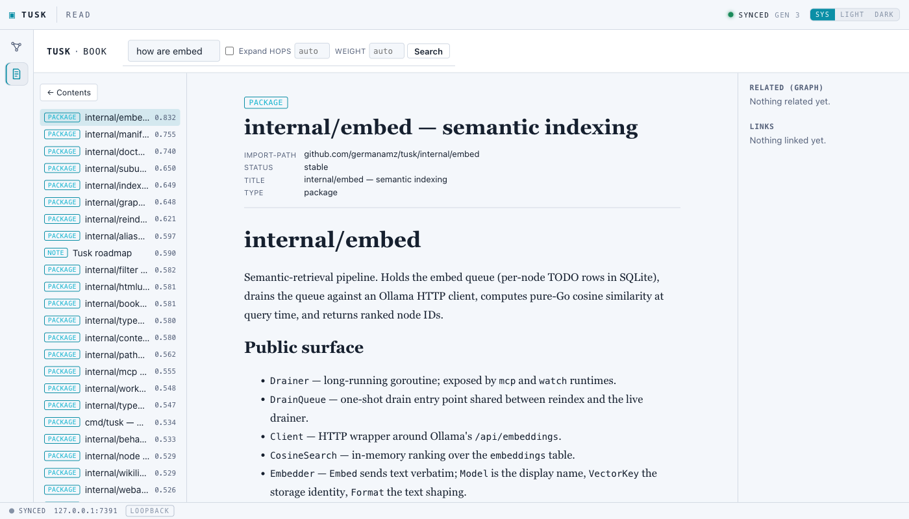

# Tusk

**Agent memory you can code-review.**

Tusk indexes a folder of markdown into a typed, searchable graph that your agents query over MCP. The memory stays plain files in git, so every change an agent makes shows up in a diff, and `tusk doctor` fails the build when a link dangles or one of your conventions breaks.

<picture>
  <source media="(prefers-color-scheme: dark)" srcset="docs/assets/tusk-web-dark.png">
  
</picture>

[Why tusk](#why-tusk) · [Install](#install) · [Try it](#try-it-on-tusks-own-docs) · [Your own notes](#use-it-on-your-own-notes) · [Connect your agent](#connect-your-agent) · [For agents](#if-youre-an-agent-setting-this-up) · [How it compares](#how-it-compares) · [Docs](#documentation)

## Why tusk

Agents write a lot: specs, plans, notes, decisions. Most agent-memory servers keep it in a database or a hosted store, where you can't diff or review it. Tusk keeps it where your team already reviews things.

- Every memory is a markdown file in git. You can review, revert or blame what an agent wrote, and Obsidian, vim and grep read the same files.
- `tusk.toml` declares node types, properties and edge types. A file that breaks the schema is still indexed, and `tusk doctor` reports it.
- Your conventions become checks. A rule is a filter that should match nothing, such as "a product note outside `docs/product/`". Doctor runs every rule and exits 1 when one matches, so a broken convention can fail CI.
- Hybrid search filters by structure, ranks by meaning with local Ollama embeddings, and returns the matching section with its heading and line range, so the agent reads a few lines instead of whole files.
- It runs locally: one Go binary and one SQLite file in `.tusk/`, with no account or hosted service.

### One query instead of grep and read

Say an agent needs to know how embedding prefixes work in this repo. `grep -ril prefix docs/packages` matches 7 files, about 60 KB to read. One hybrid query returns the section that answers it, with its text (output trimmed):

```console
$ tusk query 'type=package' --semantic "how are embedding prefixes applied to queries and documents" --take 1 --json
```

```json
[{
  "id": "docs/packages/embed",
  "title": "internal/embed — semantic indexing",
  "score": 0.909,
  "matched_units": [{
    "heading": "Public surface",
    "lines": [12, 21],
    "score": 0.909,
    "text": "- `Drainer` — long-running goroutine; …\n- `Format` — `Query`, `Document(title, payload)`, and `Header(node)` apply the `[embeddings]` prefixes and header mode. `EmbedQuery` is the query-side entry point that applies the query prefix.\n…",
    "text_lines": [14, 21]
  }],
  "units_total": 3
}]
```

Over MCP it's the `tusk_query` tool with the same arguments. That's one example. Across 40 questions about these docs, an agent using `tusk_query` cited the right section every time (98% with grep and read), made one tool call fewer and read 20% fewer input tokens per question, at about the same cost. A query result is about 5.5 KB, against under 1 KB for a grep, so the savings come from the searches and reads tusk skips: the top result carries the text of the section that matched, and most of the time the agent answers from it without opening the file. On a larger, private vault of 79 files, tusk read 17% fewer input tokens and finished 28% faster. [Benchmarks](docs/guide/benchmarks.md) has the numbers, including the questions where tusk lost.

### Conventions that fail the build

```toml
[rule.domain-matches-directory]
description = "a product note lives under docs/product/"
filter      = "type=note AND domain=product AND NOT path=docs/product/**"
```

```console
$ tusk doctor
doctor: 2 errors, 0 warnings, 0 advice
  error    [dangling-edge] docs/product/refunds: edge "references" -> "docs/product/refund-policy" (target missing); also in #S1, #S1P1
  error    [rule:domain-matches-directory] docs/technical/billing: a product note lives under docs/product/
…
$ echo $?
1
```

[Rules and doctor](docs/guide/rules-and-doctor.md) covers the rule grammar, severities and a CI recipe.

## Install

```bash
brew install germanamz/tap/tusk
```

Or, without Homebrew:

```bash
curl -fsSL https://raw.githubusercontent.com/germanamz/tusk/main/install.sh | sh
```

The script downloads the latest release for macOS, Linux or Windows (amd64 or arm64) into `~/.local/bin`. With Go 1.26+ you can run `go install github.com/germanamz/tusk/cmd/tusk@latest` instead. Semantic and hybrid search need [Ollama](https://ollama.com) running locally with an embedding model (`ollama pull nomic-embed-text`). Everything else works without it.

Updating (`tusk update`), pinning a version and building from source are in [docs/guide/install.md](docs/guide/install.md).

## Try it on tusk's own docs

This repo is a tusk vault: `docs/packages/` holds one typed page per Go package.

```bash
git clone https://github.com/germanamz/tusk && cd tusk
tusk reindex      # builds .tusk/ in about 10 seconds, embedding with Ollama if it's running
tusk web --open   # graph and reading views at http://127.0.0.1:7373
tusk query 'type=package' --semantic "what happens when the index gets corrupted"
```

Without Ollama, reindex still builds the graph, and its summary says how many nodes are left to embed.

## Use it on your own notes

Point it at the folder you already have:

```bash
cd ~/notes
tusk init --name notes   # finds your markdown and indexes it as notes
tusk reindex
tusk web --open
```

When the folder already holds markdown, `init` says how many files have no `type:`, adds the `vault` pack (note, meeting and decision types, plus wikilink edges) and sets `default-type = "note"` in `tusk.toml`. Every file then indexes as a note without being edited: its path, minus the extension, is its id, its first `# ` heading is its title, and its wikilinks become edges in any of the forms Obsidian writes: by name (`[[other-note]]`), as a path (`[[folder/other-note]]`), or relative to the note (`[[../folder/other-note]]`).

Frontmatter can still give a file another type and properties:

```markdown
---
type: decision
title: Use SSO
---

# Use SSO

Builds on [[notes/auth-rfc]].
```

Pass `tusk init --no-adopt`, or delete `default-type` from `tusk.toml`, to index only files with a `type:`.

[Workspaces, nodes and the manifest](docs/guide/workspace.md) covers types, edges, type packs and what gets indexed.

## Connect your agent

The server is `tusk mcp` over stdio. It finds the vault by walking up from the directory it starts in to the nearest `tusk.toml`. Clients that start it inside the vault need nothing else. For the rest, `--workspace` (or `-C`) names the vault and works from any directory. Without it, the server exits with `no tusk.toml in <dir> or any parent directory`.

**Claude Code.** Run this in the vault:

```bash
tusk claude install
```

It installs a project plugin that runs the MCP server and gives each session a short orientation to the vault ([details](docs/guide/mcp.md#the-claude-code-plugin)). For the server alone: `claude mcp add tusk -- tusk mcp`.

**Codex CLI.** `codex mcp add tusk -- tusk mcp`. Codex starts the server in the directory you launched it from, so to use one vault from anywhere, give it the path in `~/.codex/config.toml`:

```toml
[mcp_servers.tusk]
command = "tusk"
args    = ["mcp", "--workspace", "/path/to/vault"]
```

**Gemini CLI.** `gemini mcp add tusk tusk mcp` writes `.gemini/settings.json` in the current project. Gemini also starts the server in the launch directory; add `"--workspace", "/path/to/vault"` to `args` to pin one vault.

**VS Code.** `.vscode/mcp.json` in the vault. VS Code starts the server in the workspace folder.

```json
{ "servers": { "tusk": { "type": "stdio", "command": "tusk", "args": ["mcp"] } } }
```

**Cursor.** `.cursor/mcp.json` in the vault:

```json
{ "mcpServers": { "tusk": { "command": "tusk", "args": ["mcp"] } } }
```

Cursor doesn't document which directory it starts servers in. If the server fails with `no tusk.toml in …`, add `"--workspace", "/path/to/vault"` to `args`.

**Zed.** In your settings. Zed starts the server in the project root.

```json
{ "context_servers": { "tusk": { "command": "tusk", "args": ["mcp"] } } }
```

**Claude Desktop, Windsurf, and clients with no project folder.** Name the vault:

```json
{ "mcpServers": { "tusk": { "command": "/absolute/path/to/tusk", "args": ["mcp", "--workspace", "/path/to/vault"] } } }
```

Claude Desktop starts servers with a minimal `PATH`, so give tusk's absolute path (`which tusk` prints it). A leading `~` in the vault path is expanded, so `"~/notes"` works even though the client doesn't run a shell. If a client's config takes `env` but not `args`, set `TUSK_WORKSPACE` to the vault path instead. The flag wins over the variable, and the variable over the directory the server starts in.

The server's tools, and why agents should prefer them over the CLI, are in [docs/guide/mcp.md](docs/guide/mcp.md).

## If you're an agent setting this up

None of these commands prompt.

1. Install: `curl -fsSL https://raw.githubusercontent.com/germanamz/tusk/main/install.sh | sh` puts `tusk` in `~/.local/bin`. If `tusk --version` fails afterwards, that directory isn't on `PATH`.
2. Create the workspace in the vault root: `tusk init --name <name>`. It exits 1 if `tusk.toml` already exists, which you can treat as already done. If the folder holds markdown without a `type:`, init adds the vault pack and sets `default-type = "note"` so those files index as notes, and says so in its output; `--no-adopt` skips this.
3. Declare types, unless init already added the vault pack: `tusk pack add vault` adds note, meeting and decision types. Built-in packs ship inside tusk, so it works offline. It exits 1 if run twice (`--force` overwrites). Or write `[node-types.*]` in `tusk.toml` yourself.
4. Index: `tusk reindex`. If its summary ends with `queued for embedding (embedder unreachable)`, Ollama isn't reachable: the graph was built, and only semantic search is missing. It still exits 0.
5. Connect the client as described in [Connect your agent](#connect-your-agent). For Claude Code, run `tusk claude install`.
6. Verify: `tusk status` prints node counts by type, so non-zero counts mean files were indexed. `tusk doctor` exits 0 when the vault is healthy and 1 when an error is present, listing errors first.

Commands exit 0 on success and non-zero on failure. `tusk query`, `node list`, `node get`, `edge list`, `context` and `run` take `--json`. `tusk reset` asks for confirmation unless you pass `--yes`. Once the MCP server is connected, use the `tusk_*` tools instead of the shell, and call `tusk_help` for the filter grammar and workflows.

A prompt you can paste into your agent:

> Install tusk (https://github.com/germanamz/tusk) and set it up for this folder. Follow the "If you're an agent setting this up" section of its README, connect it as an MCP server for this client, then run `tusk status` and `tusk doctor` and show me the output.

## How it compares

**grep and ripgrep** need no setup and are exact when you know the words. Tusk adds search by meaning, a schema, and links you can query. It costs an index, and Ollama for semantic search.

**Obsidian** is a good editor for the same kind of vault, and the two can share a folder: Obsidian for writing, tusk for agents and checks. Tusk resolves the links Obsidian writes, short names, heading links and block references included, and `tusk node move` keeps them pointing where they did.

**A vector database or RAG pipeline** scales further, with more embedding models and hosted options. Tusk's index is derived from files you can read and review, and structure (types, edges, rules) is queryable in the same call as similarity. Tusk only talks to Ollama today.

**Agent-memory MCP servers** are easier to start with, because the agent just writes memories. Most keep them in a database, a JSON file or a hosted service, which you can't diff, review or fix in an editor. Tusk asks for more upfront (a schema), and in return you can review the memory.

### Where tusk falls short

- Semantic search needs Ollama running locally. There's no hosted embedding provider yet.
- One writer at a time per workspace: an advisory lock serializes writes from the CLI and the MCP server.
- Similarity ranking is brute-force cosine in memory. That suits a personal or team vault, not millions of documents.

## Documentation

- [Install and update](docs/guide/install.md)
- [Workspaces, nodes and the manifest](docs/guide/workspace.md): node files, edges, path refs, type packs, indexing
- [Querying](docs/guide/querying.md): the filter grammar, semantic search, embedding settings
- [Rules and doctor](docs/guide/rules-and-doctor.md): health checks, conventions, CI
- [Benchmarks](docs/guide/benchmarks.md): what an agent spends answering with `tusk_query` against grep and read
- [MCP server and Claude Code plugin](docs/guide/mcp.md): the server, the plugin, the tool list
- [CLI reference](docs/cli/README.md) and [workflows](docs/cli/workflows.md); man pages are in [`man/`](man/) (`man -M man tusk` after cloning)
- [PRODUCT.md](PRODUCT.md): what tusk is for, and its design principles
- [llms.txt](llms.txt): these docs, indexed for agents, and [llms-full.txt](llms-full.txt), all of them in one file
- [Roadmap](docs/roadmap.md)

Questions go in [Discussions](https://github.com/germanamz/tusk/discussions), bugs and ideas in [issues](https://github.com/germanamz/tusk/issues).

## Development

```bash
make build        # ./bin/tusk
make test         # unit tests
make test-race    # with race detector
make vet
make lint         # golangci-lint
make fmt
```

See [`STYLE.md`](STYLE.md) for the codebase conventions and [`CONTRIBUTING.md`](CONTRIBUTING.md) for how to propose changes.

## License

[Apache 2.0](LICENSE)
