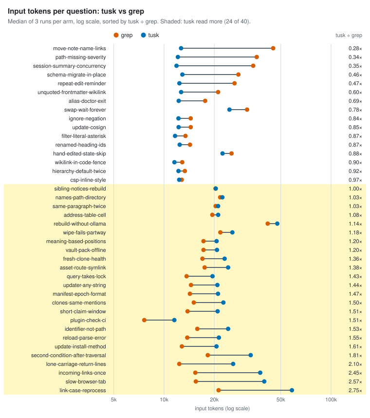
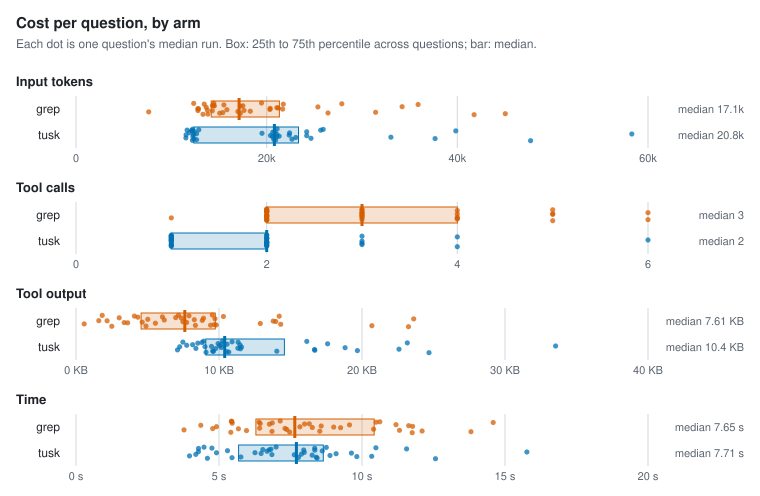
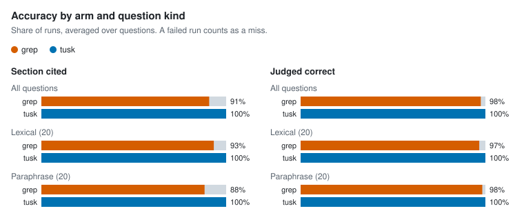

# Benchmarks

Does an agent spend less to answer a question with `tusk_query` than with grep and read? To find out, Claude Code answered 40 questions about tusk's own package docs, three times with grep and read and three times with `tusk_query` and read, and the harness counted what each run spent.

With tusk, the agent cited the right section on every run (91% with grep) and made one tool call fewer per question (2 against 3). It also read 11% more input tokens per question and cost 37% more, and took the same time. On this corpus tusk buys accuracy, not tokens. A query result runs about 8 KB, where a grep result runs under 1 KB, so tusk comes out ahead only on questions where grep has to dig.

Four later changes shifted this. [Lexical fusion](#lexical-fusion) ranks the answer higher, [Smaller results](#smaller-results) halved the size of a query result, [Passage text](#passage-text) puts the matched section's text in the result, so the agent can often skip the Read, and [Per-turn overhead](#per-turn-overhead) trimmed what the tusk MCP server adds to every turn. A fifth, [Title match](#title-match), ranks a page higher when the query names it, and left what an agent spent here unchanged. On the latest full run, on 10-16, tusk read 30% fewer input tokens than grep per question (0.70×, with an interval from 0.58 to 0.83), cost 9% more, within the noise, made one tool call fewer and cited the right section on every run (97% with grep).

A second, larger corpus came out the other way on tokens. On a private vault of 79 files, tusk read 17% fewer input tokens, made two tool calls fewer and finished 28% faster, and accuracy was about the same. See [A second corpus](#a-second-corpus).

## Results

| | grep and read | `tusk_query` and read | tusk against grep, per question |
| --- | --- | --- | --- |
| Input tokens | 17,108 | 20,809 | 1.11× (0.91–1.41) |
| Tool calls | 3 | 2 | −1 (−1 to 0) |
| Tool output | 7.6 KB | 10.4 KB | 1.41× (1.18–2.11) |
| Time | 7.7 s | 7.7 s | 0.99× (0.84–1.10) |
| Cost | $0.024 | $0.033 | 1.37× (1.26–1.64) |
| Cited the right section | 91% | 100% | +9 points (+2 to +17) |
| Judged correct | 98% | 100% | +2 points (0 to +7) |

The first two columns are medians over questions, taking each question's median run. The last column compares the arms question by question: the median of tusk's ratio (or difference) to grep, with a 95% confidence interval in brackets. A 1.11× ratio whose interval runs from 0.91 to 1.41 means tusk probably reads somewhat more, and the benchmark can't rule out no difference.

<picture>
  <source media="(prefers-color-scheme: dark)" srcset="../../eval/results/2026-10-14-tusk-docs/charts/tokens-tusk-vs-grep-dark.svg">
  
</picture>

<picture>
  <source media="(prefers-color-scheme: dark)" srcset="../../eval/results/2026-10-14-tusk-docs/charts/per-arm-dark.svg">
  
</picture>

<picture>
  <source media="(prefers-color-scheme: dark)" srcset="../../eval/results/2026-10-14-tusk-docs/charts/accuracy-dark.svg">
  
</picture>

Splitting by question kind doesn't change the picture. On lexical questions, which share a distinctive word with their section, tusk read 16.2k tokens to grep's 15.1k. On paraphrase questions it read 21.7k to 17.8k. Grep cited the right section on 93% of lexical runs and 88% of paraphrase runs; tusk did on all of them.

Some of grep's citation misses are near misses: a bullet name or a bold label cited as if it were a heading, or the file's title instead of the section under it. Tusk's results name the heading of each matched section, so its citations come out exact. The judge's verdict is the better measure of the answers themselves. It marked three grep runs wrong. Two of those said no flag makes a `path-missing` finding fail CI, missing `--fail-on warning`. It marked no tusk run wrong.

## Where tusk lost

Tusk read more input tokens than grep on 24 of the 40 questions. Three things account for it.

**Every query costs about 8 KB.** A `tusk_query` result has a median size of 8.4 KB. It holds five results, each with up to three matched sections, and every section carries its id, parent id, type, heading level, line range, ordinal and score around a snippet of about 150 characters. A Grep result has a median of 0.7 KB and a Read 2.9 KB. Input tokens count the whole context once per turn, so a big result early in a run is paid for again on every turn after it. On `lone-carriage-return-lines` (2.10×), both arms took one search and one read. Tusk's query found `linenum.md` right away, but returned 8 to 15 KB, where grep's search and read came to 2 KB together. `reload-parse-error`, `update-install-method` and `plugin-check-ci` go the same way, and most of the 1.2× to 1.6× losses are this.

**The agent reads the file anyway.** The snippets point at the answer but rarely contain it, so the agent follows up with Read: 73 of the 120 tusk runs read a file, against 92 of the 120 grep runs.

**A miss costs several queries.** The largest losses come from first queries that ranked other pages above the answer:

- `link-case-reprocess`, 2.75×: "link-case change forces full re-process of vault" ranked `doctor.md` and `pathref.md` above the `reindex.md` "Notes" section that holds the answer. The agent ran up to three more queries and read all of `wikilink.md` before it got there.
- `slow-browser-tab`, 2.57×: the first query's top five didn't include `webui.md` at all, and in two of the three runs the agent read `webapp.md` or `bookview.md` before finding it.
- `incoming-links-once` (2.45×) and `second-condition-after-traversal` (1.81×): the agent re-queried with different wording before reading.

Tusk won when grep had to dig. On `move-note-name-links` (0.28×), `path-missing-severity` (0.34×) and `session-summary-concurrency` (0.35×), the question's words (move, rename, exit, doctor, queries) match lines all over the corpus. Grep ran three to seven searches and read several sections, while one query landed on the section.

So the follow-ups to try are smaller query results (fewer fields per matched section, fewer sections by default), returning the matched section's text when it's short so the agent doesn't need a Read, and better ranking for long sections that cover several topics ([Lexical fusion](#lexical-fusion) covers that one, [Smaller results](#smaller-results) the first and [Passage text](#passage-text) the second). This benchmark is how to tell whether they work.

## A second corpus

The same harness ran with the same model and settings on a private vault of 79 markdown files and 684 sections: more than twice the files and four and a half times the sections of `docs/packages`. Its 40 questions were written the same way, half lexical and half paraphrase. The vault isn't public, so only the numbers are published.

| | grep and read | `tusk_query` and read | tusk against grep, per question |
| --- | --- | --- | --- |
| Input tokens | 20,186 | 12,446 | 0.83× (0.63–0.93) |
| Tool calls | 3 | 1 | −2 (−2 to −1) |
| Tool output | 8.2 KB | 9.7 KB | 1.18× (1.06–1.65) |
| Time | 9.2 s | 6.1 s | 0.72× (0.65–0.82) |
| Cost | $0.027 | $0.028 | 1.10× (0.90–1.18) |
| Cited the right section | 95% | 97% | +2 points (−4 to +8) |
| Judged correct | 97% | 93% | −3 points (−8 to 0) |

Tusk read fewer input tokens on 28 of the 40 questions and finished faster on 33. Most of the gap is on paraphrase questions: tusk read 12.5k tokens to grep's 26.5k, and made 1 call to grep's 4. On lexical questions it read 12.4k to 16.0k. A query still returns more than a grep does. On a bigger corpus, though, grep needs more searches and reads to land, and every extra turn pays for the whole context again.

Cost came out about even anyway, because of the prompt cache. Tusk's larger results are new text, written to the cache, and a cache write costs about 12 times a cache read. Tusk wrote a median of 5.3k tokens to the cache against grep's 4.3k, and read 11.3k from it against grep's 15.5k.

The judge marked tusk wrong a little more often, 93% against 97%, but the interval reaches zero. In both arms, most wrong verdicts were right answers with an added claim the reference contradicts.

## Embedding prefixes

`nomic-embed-text` is trained with a prefix on each side, `search_query: ` for queries and `search_document: ` for documents, and `tusk doctor` suggests setting them. On the private vault above they raised note-level MRR@10 from 0.533 to 0.650 ([#758](https://github.com/germanamz/tusk/issues/758)). The runs above had them off. To see whether they also cut what an agent spends, the benchmark ran twice more on one day, with one binary and one copy of the docs ([#811](https://github.com/germanamz/tusk/issues/811)): a full run with both prefixes set, then the tusk arm again without them. The two share one set of grep runs.

| `tusk_query` and read | Prefixes off | Prefixes on | On against off, per question |
| --- | --- | --- | --- |
| Input tokens | 21,156 | 22,588 | 1.03× (1.01–1.05) |
| Tool calls | 2 | 2 | 0 (0 to 0) |
| Tool output | 10.9 KB | 12.0 KB | 1.06× (1.00–1.14) |
| Time | 6.7 s | 6.8 s | 0.98× (0.94–1.04) |
| Cost | $0.033 | $0.036 | 1.05× (1.02–1.08) |
| Cited the right section | 100% | 100% | |
| Judged correct | 100% | 100% | |

The last column reads like the one in [Results](#results): the median ratio (or difference) over questions, with a 95% confidence interval.

With the prefixes on, the agent spent a little more: 3% more input tokens and 5% more cost per question, with the same tool calls and every answer correct either way. The questions whose first query had ranked the answer low didn't get cheaper. `link-case-reprocess` read 39.7k tokens without the prefixes and 40.6k with them, even though its section moved from tenth to first.

Ranking improved slightly. Scored offline for the 40 questions, using the first query the agent sent in each tusk run of the 10-14 benchmark, the answering section's MRR@10 rose from 0.62 to 0.67. Resampled by question, the 95% interval of that gain runs from −0.03 to +0.14. File-level MRR@10 didn't move (0.80 and 0.79). On this corpus the first query usually finds the right file with or without the prefixes, and as [Where tusk lost](#where-tusk-lost) found, the agent then reads the file anyway, so a better section rank rarely saves it a step.

The prefixes also raise every score. Over those queries and the 40 questions, 80% of query-to-file scores reach 0.5 without the prefixes and 99% with them, so `tusk_query`'s default `min_score` of 0.5 filters almost nothing once they're on.

This repo's `tusk.toml` sets both prefixes, as the model card says to, but tusk doesn't turn them on by default. Both vaults ranked better with them (here within the noise), an agent on this corpus gained nothing from it, and a default would re-embed every `nomic-embed-text` vault and change what `min_score` means for it. The runs are in [`eval/results/2026-10-15-nomic-prefixes/`](../../eval/results/2026-10-15-nomic-prefixes/) and [`eval/results/2026-10-15-nomic-no-prefixes/`](../../eval/results/2026-10-15-nomic-no-prefixes/).

Both arms read more in these runs than on 10-14: tusk 21.2k and 22.6k tokens against 20.8k, grep 18.0k against 17.1k. The docs, the tusk binary and Claude Code (2.1.300) all changed in between, which is why the comparison above uses a same-day control rather than the 10-14 numbers.

## Lexical fusion

The largest losses in [Where tusk lost](#where-tusk-lost) came from first queries that ranked other pages above the answer ([#812](https://github.com/germanamz/tusk/issues/812)). In `slow-browser-tab` the answer is half a sentence at the end of a 1 KB bullet that also covers SSE event names, the payload producer and the poll loop, and its section ranked 73rd for the agent's first query. The vector of a long passage barely reflects one clause in it, and the identifier-heavy "Public surface" lists every package doc has score moderately against almost any query.

Two fixes were tried offline first, by replaying the first `tusk_query` of every tusk run from the three earlier benchmark runs (350 queries over the 40 questions) and checking where the answering section ranked. That's `go run ./eval/agentbench probe` (see [`eval/README.md`](../../eval/README.md)). Each question's figure is the mean over its queries, so every question weighs the same.

**Windows.** Passages over 400 bytes were split into overlapping windows of about 300 bytes, cut at sentences, each embedded on its own and scored as the best of its windows. `slow-browser-tab` rose from 73rd to 7th, but every other long passage also got several tries at a high score, and questions that had ranked first slipped. Section MRR@10 stayed at 0.65, the answer reached the result an agent sees no more often, and the vault would hold 46% more vectors. Windows weren't kept.

**Words.** `[query] lexical-weight` scores each passage's words against the query with BM25, scaled so the best passage scores 1, and raises its cosine by that share of the gap to 1: `cosine + weight × lexical × (1 − cosine)`. At a weight of 0.5:

| Replayed first queries | Prefixes, off | Prefixes, on | No prefixes, off | No prefixes, on |
| --- | --- | --- | --- | --- |
| Section MRR@10 | 0.653 | 0.738 (+0.017 to +0.158) | 0.598 | 0.703 (+0.032 to +0.184) |
| Section ranked first | 55% | 66% | 49% | 61% |
| Section in the top 10 | 81% | 91% | 81% | 90% |
| Section in the agent's result | 86% | 93% | 85% | 94% |
| File MRR@10 | 0.772 | 0.855 (+0.026 to +0.149) | 0.780 | 0.839 (−0.002 to +0.126) |

The brackets are 95% intervals of the per-question difference. "The agent's result" is five files with three matched sections each: the five files the benchmark's agents asked for, and the three sections `tusk_query` returned per file by default at the time. The four questions [Where tusk lost](#where-tusk-lost) names reached it on every replayed query, with or without the prefixes; before, `slow-browser-tab` never did. With the prefixes, `slow-browser-tab` moved from 73rd to 3rd and `second-condition-after-traversal` from 18th to 8th; without them, `link-case-reprocess` moved from 10th to 1st.

Replaying each question's full text instead of the agent's query made no measurable difference: section MRR@10 moved by −0.008 (−0.099 to +0.086) with the prefixes and +0.036 (−0.043 to +0.117) without. The agent's first queries are short strings of keywords, which is where a word match helps. Weights from 0.5 to 1 scored within noise of each other; 0.5 was best with the prefixes and 0.75 without. Adding the word score to the cosine outright ranked about the same, but can push a score past 1.

**What it did for an agent.** The tusk arm then ran twice on one day with one binary and one copy of the docs: once with this repo's `tusk.toml` (prefixes on, `lexical-weight = 0.5`) and once with the weight removed.

| `tusk_query` and read | Lexical off | Lexical on | On against off, per question |
| --- | --- | --- | --- |
| Input tokens | 21,910 | 13,473 | 0.99× (0.98–1.00) |
| Tool calls | 2 | 1 | 0 (0 to 0) |
| Tool output | 11.1 KB | 10.6 KB | 0.96× (0.93–1.00) |
| Time | 7.2 s | 6.2 s | 0.89× (0.82–1.03) |
| Cost | $0.032 | $0.030 | 0.98× (0.96–1.01) |
| Cited the right section | 100% | 100% | |
| Judged correct | 98% | 99% | |

The first two columns overstate the change. Most questions take either one query (about 13k tokens) or a query and a Read (about 22k), and the median question moved from the second group to the first. Question by question, 20 of the 40 stayed within 5% of the control, so the typical ratio is 0.99. The change is in the tail: 12 questions read 35% to 70% fewer tokens, among them `link-case-reprocess` (0.32×), `slow-browser-tab` (0.59×) and `second-condition-after-traversal` (0.65×), and the mean question read 19% fewer (22.0k against 17.7k). Over all 120 runs, input tokens fell 15% and cost 9%.

One question's ratio is noisy. The earlier run with the same settings, made the same day before this change, differed from the control by more than 20% on 13 questions, 5 cheaper and 8 dearer. What lifts the result above that noise is where the savings fell. The 13 questions whose answer the probe ranked higher read 33% fewer tokens in total, the 22 it left alone 15% fewer, and the 5 it ranked lower 11% more.

Three questions read about 70% more, each through one extra Read. In `short-claim-window` the query still ranked the right section first, but a different passage stood for it: the section's opening paragraph shares more of the query's words than the paragraph with the answer, so the agent got the opening as its snippet and went to read the file. Weighing words as well as meaning can pick, inside a section, the passage that names the topic over the one that answers it.

Tusk leaves lexical fusion off by default. The weight was chosen on the same queries it was scored on, one corpus is all it was measured on, and full-sentence queries didn't gain. This repo's `tusk.toml` turns it on. The runs are in [`eval/results/2026-10-15-lexical-on/`](../../eval/results/2026-10-15-lexical-on/) and [`eval/results/2026-10-15-lexical-off/`](../../eval/results/2026-10-15-lexical-off/).

## Smaller results

A `tusk_query` result had a median size of 9.9 KB in the control run below, and only about a quarter of it was passage text ([#813](https://github.com/germanamz/tusk/issues/813)). Each result repeated its first section's snippet, and each matched section carried its parent id, type, heading level and ordinal next to a score printed to 16 digits. The agent pays for every one of those bytes again on each turn after the query.

A result now carries less:

- A result with matched sections has no snippet of its own.
- A matched section carries `id`, `heading`, `lines`, `score` and `snippet`. The structural `include=["units"]` outline keeps the other fields.
- With `include=["body"]`, the first section leaves its snippet out, since `body` already holds that passage in full.
- Scores are rounded to three decimals.
- `tusk_query` returns 5 files unless `take` says otherwise (it was 10) and 2 sections per file unless `max_units` does (it was 3).

Replayed offline in the new shape, the 123 query results of the lexical-fusion run shrank by 34% before the new defaults. The probe measured what the new defaults cost. Over the same replayed first queries, the answering section reached the result an agent sees 94% of the time with 3 sections per file and 88% with 2. Five files against ten made less difference (94% and 95%), and the agents here asked for five in 111 of 123 calls anyway, so the `take` default only matters to callers that leave it out.

The tusk arm then ran on one day with one copy of the docs, once with the binary from `main` before the change and once after, alongside a fresh grep arm.

| `tusk_query` and read | Before | After | After against before, per question |
| --- | --- | --- | --- |
| Input tokens | 21,566 | 17,506 | 0.85× (0.83–0.85) |
| Tool calls | 2 | 2 | 0 (0 to 0) |
| Tool output | 10.6 KB | 6.2 KB | 0.57× (0.53–0.59) |
| Time | 6.4 s | 6.7 s | 1.04× (0.93–1.13) |
| Cost | $0.033 | $0.024 | 0.74× (0.72–0.77) |
| Cited the right section | 98% | 100% | |
| Judged correct | 98% | 98% | |

The median query result fell from 9.9 KB to 4.9 KB. Over all 120 runs, input tokens fell 12% and cost 22%. Cost fell further than tokens because a query result is new text, written to the prompt cache at about 12 times the price of a read from it.

The smaller section cap has a price. In 14 of the 120 runs, the first query returned the file that holds the answer but cut the answering section, against 9 with three sections per file, and the agent read the file every time. Runs with a Read went from 58 to 68 in all. Four questions got dearer. The two worst, `session-summary-concurrency` (1.67×) and `unquoted-frontmatter-wikilink` (1.60×), each took an extra query or Read in two of their three runs. The other 36 read less, 35 of them by more than 5%, so the smaller results saved more than the extra Reads cost.

Against the grep arm of the same run, tusk read 0.84× the input tokens per question (0.76–1.06), less on 25 of the 40 questions, and cost 1.03× (0.90–1.20). The `main` binary, set against the same grep runs, read 0.99× (0.84–1.21) and cost 1.36×. The runs are in [`eval/results/2026-10-15-smaller-results/`](../../eval/results/2026-10-15-smaller-results/) (both arms) and [`eval/results/2026-10-15-smaller-results-main/`](../../eval/results/2026-10-15-smaller-results-main/) (the control).

## Passage text

Even with smaller results, the agent read a file after its query in 68 of 120 runs ([#814](https://github.com/germanamz/tusk/issues/814)). A matched section's snippet is 200 characters around the first query word it contains, and that is often not the sentence that answers. Of the 47 Reads that asked for a line range, 30 asked for the top result's first section, give or take two lines.

So the top result's best section now carries its own text in place of the snippet. That `text` is the markdown between the section's heading and its first subsection, read from the file, and `text_lines` says which lines of the file it covers. A section over 2 KB comes as a window of whole paragraphs and list items around the one that matched. `include=["body"]` gives every result's best section its text. The paragraph or bullet that scored would have been too narrow on its own. On `lone-carriage-return-lines` the bullet that matched names the `universal` scheme, and the answer needs the bullet above it, which says `lf` is the default.

The tusk arm ran on one day with one copy of the docs, once with the binary from `main` and once with the change, alongside a fresh grep arm.

| `tusk_query` and read | Before | After | After against before, per question |
| --- | --- | --- | --- |
| Input tokens | 17,868 | 12,348 | 0.98× (0.68–1.10) |
| Tool calls | 2 | 1 | 0 (−1 to 0) |
| Tool output | 5.9 KB | 7.2 KB | 1.06× (0.92–1.36) |
| Time | 6.4 s | 5.9 s | 1.02× (0.94–1.14) |
| Cost | $0.025 | $0.024 | 1.01× (0.92–1.16) |
| Cited the right section | 100% | 100% | |
| Judged correct | 100% | 100% | |

The medians in the first two columns move much further than the ratio per question, because the change splits the questions in two. Runs with a Read fell from 70 to 32. Seventeen questions read 24% to 47% fewer tokens, and in 16 of them fewer runs read a file. Eleven questions were answered by one query in both runs, and nine of those read 10% to 23% more, since the section text rides along on every later turn. Over all 120 runs, input tokens fell 10% and tool calls 22% (211 to 165). Cost stayed flat: the text is new to the prompt cache, written at about 12 times the price of a cached read, so the bigger results cost about what the skipped turns saved.

Of the 32 runs that still read a file, 22 read the second, third or fourth result, because the top result held a different section. The other 10 read the top file. In one, the answer sat just past the 2 KB window. In the other nine, the text came from a section that doesn't answer the question, in six of them the file's "Public surface" list. One question got much dearer. In `slow-browser-tab` (1.78×) the answer is in the third result. The control's agents passed `include=["body"]` on all three runs, which gave every result its best paragraph in full. After the change, two of the three runs left `body` out, saw only a snippet for the third result, and read the file. With the top section's text arriving anyway, agents asked for `body` in 37 of 128 queries, against 79 of 133 before.

Against the grep arm of the same run, tusk read 0.80× the input tokens per question (0.70–0.94), less on 31 of the 40 questions, and cost 1.05× (0.90–1.29). The `main` binary, set against the same grep runs, read 0.91× (0.80–1.08). The runs are in [`eval/results/2026-10-15-passage-text/`](../../eval/results/2026-10-15-passage-text/) (both arms) and [`eval/results/2026-10-15-passage-text-main/`](../../eval/results/2026-10-15-passage-text-main/) (the control).

## Per-turn overhead

Every turn of an agent connected to `tusk mcp` carries the server's instructions and the definitions of the tools it may call ([#815](https://github.com/germanamz/tusk/issues/815)). On the 10-15 run the tusk arm's first turn came to 4,413 tokens and the grep arm's to 3,623, though the tusk arm has two tools fewer. The instructions ran to 1,810 characters, much of it for agents that write: how to declare a type, when to call `tusk_reload`, what to do about a wedged index. The `tusk_query` definition ran to 3.9 KB, most of it filter grammar.

Both are now written for a model rather than a person, in terse shorthand. The instructions keep what every agent needs: where the vault is, that the tools beat the shell, and where `tusk_help` goes deeper. The writer guidance moved into the descriptions of `tusk_reload` and `tusk_reset` and into the `workflow` help topic, so it travels only with the tools it concerns. The `tusk_query` description keeps the common filter shapes and points to `tusk_help(topic: "filter")` for the rest. Together they went from 5.7 KB to 2.3 KB, and a test holds them under a budget. The tusk arm's first turn fell to 3,163 tokens, 460 below the grep arm's.

The first draft cost more than it saved. It listed `include`'s values as `body|edges|properties|units|paths`, and agents copied the shape: 39 of 174 queries sent `"include": body`, which isn't JSON, so Claude Code rejected the call and the agent tried again. The values are now written as JSON (`["body","edges",…]`), and none of the 130 queries below failed. Earlier runs had up to three such failures each. The first draft's runs are in [`eval/results/2026-10-16-per-turn-overhead-bare-include/`](../../eval/results/2026-10-16-per-turn-overhead-bare-include/).

The tusk arm ran on one day with one copy of the docs, once with the binary from `main` and once with the change, alongside a fresh grep arm.

| `tusk_query` and read | Before | After | After against before, per question |
| --- | --- | --- | --- |
| Input tokens | 12,690 | 10,698 | 0.88× (0.82–0.92) |
| Tool calls | 1 | 1 | 0 (0 to 0) |
| Tool output | 7.0 KB | 10.1 KB | 1.33× (1.02–1.63) |
| Time | 7.3 s | 8.6 s | 1.11× (1.01–1.37) |
| Cost | $0.025 | $0.026 | 1.06× (0.94–1.13) |
| Cited the right section | 100% | 100% | |
| Judged correct | 98% | 98% | |

Input tokens fell on 32 of the 40 questions, and by 12% over all 120 runs. The shorter definition also changed what agents asked for. The old `include` description said, deep in a long parenthetical, that `body` gives every semantic row its best section's text. The new one says it in a line of its own, and agents passed `include: ["body"]` on all 130 queries, against 45 of 132 before. That took the median query result from 5.7 KB to 9.3 KB. It saved some Reads (30 against 39). It also accounts for most of the eight questions that got dearer, five of them by 1.5 to 2 times. On `fresh-clone-health` the agent now reads a 20 KB result and then the file, where the control answered from a 5 KB result. A bigger result is new text for the prompt cache, written at about 12 times the price of a cached read, and the tokens saved on every turn were cached reads. So cost rose 6%, within the noise.

The docs corpus has no typed notes, and 3 of the 130 queries used a filter at all, so this benchmark can't tell whether the shorter filter grammar costs anything on a vault that leans on structural queries.

Against the grep arm of the same run, tusk read 0.70× the input tokens per question (0.58–0.83), less on 30 of the 40 questions, and cost 1.09× (0.93–1.28). The `main` binary, set against the same grep runs, read 0.81× (0.68–0.94). The runs are in [`eval/results/2026-10-16-per-turn-overhead/`](../../eval/results/2026-10-16-per-turn-overhead/) (both arms) and [`eval/results/2026-10-16-per-turn-overhead-main/`](../../eval/results/2026-10-16-per-turn-overhead-main/) (the control).

## Title match

A query that names a page could rank it below longer notes that mention it more often ([#849](https://github.com/germanamz/tusk/issues/849)). Passages are embedded without their file's title. In a workspace with a `ledger-sync` service and eight incident write-ups that name the service in every paragraph, `which topic does ledger-sync consume` ranked all eight incidents (0.71) above the service (0.60), and the service's `Async` section, which holds the answer, scored 0.49. Lexical fusion made it worse, because the incidents use every word of the query.

`[query] title-weight` scores how much of each file's title the query names: the share of the title's words the query also uses, or of the file name when there is no title. Every passage of the file closes that share of its gap to 1, as with the word match. At 0.5 the service ranked first at 0.80. With `lexical-weight = 0.5` as well it stayed ninth (0.83 against 0.86) until the title weight reached 0.7 (0.89).

On tusk's package docs, replaying the 359 first queries agents sent in the 10-15 and 10-16 runs, with this repo's `tusk.toml` (`lexical-weight = 0.5`):

| Replayed first queries | Off | 0.3 | 0.5 | 0.7 |
| --- | --- | --- | --- | --- |
| Section MRR@10 | 0.733 | 0.740 | 0.759 (+0.001 to +0.053) | 0.769 (+0.003 to +0.073) |
| Section ranked first | 66% | 66% | 68% | 68% |
| Section in the top 10 | 90% | 90% | 94% | 93% |
| Section in the agent's result | 92% | 92% | 92% | 92% |
| File MRR@10 | 0.866 | 0.869 | 0.895 (+0.004 to +0.062) | 0.903 (+0.003 to +0.079) |

Without lexical fusion a weight of 0.5 moved section MRR@10 from 0.649 to 0.674 (−0.012 to +0.071) and file MRR@10 from 0.757 to 0.825 (+0.011 to +0.133). Replaying each question's full text instead, the answering section reached the agent's result for 90% of questions instead of 80% (+2.5 to +20 points) at both 0.5 and 0.7.

Here the gain comes from partial matches. Every title reads `internal/<package> — <what it does>`, and an agent's query names the package and maybe one more of the title's words, so it matches 0.2 to 0.4. Squaring the share, to favor queries that name the whole title, left only +0.007 of the gain at 0.5. Partial matches also cost the one question that slipped: in `incoming-links-once` the query says "page", and so does the title of `internal/pathref — workspace paths a page names`, which climbed above the answer and pushed the section from first to second or third on 2 of the question's 9 queries at 0.5 and on 4 at 0.7 (MRR@10 0.94 to 0.81 and 0.70). That is why the default is 0.5 although 0.7 scored higher.

The word match changed in the same release: a final "e" is now dropped after the suffix, so "node" meets "nodes" and "consume" meets "consumes". With the title match off it moved nothing (section MRR@10 0.731).

**What it did for an agent.** The tusk arm ran twice on one day with one copy of the docs and this repo's `tusk.toml`, once with the binary from `main` and once with the title match at its default.

| `tusk_query` and read | `main` | Title match | Title match against `main`, per question |
| --- | --- | --- | --- |
| Input tokens | 10,654 | 10,514 | 1.00× (0.98–1.00) |
| Tool calls | 1 | 1 | 0 (0 to 0) |
| Tool output | 10.4 KB | 10.2 KB | 1.00× (0.99–1.01) |
| Time | 7.6 s | 7.9 s | 1.02× (0.85–1.09) |
| Cost | $0.026 | $0.026 | 0.98× (0.95–1.00) |
| Cited the right section | 95% | 95% | |
| Judged correct | 95% | 93% | |

An agent barely noticed. 28 of the 40 questions stayed within 5% of the control, Reads went from 34 to 31 over the 120 runs, and total input tokens fell 0.8% and cost 4.5%. Two more answers were judged wrong, one run each on two questions, within the noise [Lexical fusion](#lexical-fusion) measured between identical runs. On this corpus the agent's first query already finds the right file most of the time, so a better rank rarely saves it a step. The title match is for vaults where notes about a subject outnumber the page on it. The runs are in [`eval/results/2026-10-28-title-match/`](../../eval/results/2026-10-28-title-match/) and [`eval/results/2026-10-28-title-match-main/`](../../eval/results/2026-10-28-title-match-main/) (the control).

## How it was measured

The harness is [`eval/agentbench`](../../eval/README.md), and every run's raw record is in [`eval/results/2026-10-14-tusk-docs/`](../../eval/results/2026-10-14-tusk-docs/).

**Corpus.** [`docs/packages/`](../packages/): 34 markdown files, one per internal Go package, 164 KB and 149 headed sections. Each run gets a fresh copy. The grep arm's copy is plain markdown; the tusk arm's copy also has the index, built once by `tusk reindex` before any agent ran, with `nomic-embed-text` embeddings from a local Ollama and no instruction prefixes (see [Embedding prefixes](#embedding-prefixes)).

**Questions.** [40 questions](../../eval/tasks/tusk-docs.jsonl), each with the section or sections that answer it, spread over 28 of the 34 files. Half are *lexical*: they share a distinctive word with their section, so a grep for it lands. The other half are *paraphrase*: they describe the situation in other words ("What happens when you rebuild the index while Ollama isn't running?"). The questions were written by reading the files, not by searching with either arm's tools, so neither arm picked its own questions.

**Arms.** Both run Claude Code 2.1.299 headless (`claude -p`) with Claude Sonnet 5.5, the same short system prompt (answer from the docs in this directory, cite file and heading) and the same JSON schema for the answer. They differ only in their tools:

| Arm | Tools |
| --- | --- |
| grep | Grep, Glob, Read |
| tusk | `tusk_query` (the MCP server from this repo at commit 1ab211a) and Read |

Claude Code runs with `--restricted` and `--strict-mcp-config`, so no user settings, other MCP servers or code-running tools reach either arm, and the harness checks every run's tool list against its arm. Each question ran 3 times per arm, 240 runs in all, in shuffled order, 4 at a time.

**What's recorded.** For every run: tool calls (not counting the final structured answer), input tokens, tool output in bytes, wall time and cost as Claude Code reports it. Input tokens are everything the model read across all turns, cached or not, so they measure context size independent of caching. They include Claude Code's own system prompt and tool definitions, about 3.6k tokens per turn for the grep arm and 4.1k for the tusk arm, whose MCP tool schema and server instructions add about 500. Since [Per-turn overhead](#per-turn-overhead) the tusk arm's is 3.2k.

**Scoring.** An answer cites the right section when one of its citations names a target heading in the target file, or a heading nested inside it. A judge model (Claude Haiku 5.5) then compares the answer with the text of the target section and marks it correct or not. A failed run counts as a miss on both.

**Statistics.** Each question's figure is the median of its 3 runs. Arms are compared question by question: the tusk ÷ grep ratio for each question, then the median ratio, with a 95% confidence interval from 10,000 bootstrap resamples over questions.

## Limits

- One model and two corpora, both small. On 34 files with distinctive names and headings, grep is hard to beat. On 79 files tusk already reads less. Larger vaults are untested.
- The questions were written by Claude, reading the files, and labeled lexical or paraphrase by the same hand.
- Cost depends on prompt-cache hits, which depend on how runs overlap. Input tokens don't, which is why they're the headline.

## Run it yourself

```bash
make build
go run ./eval/agentbench run --tasks eval/tasks/tusk-docs.jsonl --paths docs/packages \
  --out eval/results/$(date +%F)-tusk-docs
```

You need the `claude` CLI logged in and Ollama running with `nomic-embed-text`. The harness copies this repo's `tusk.toml`, which now sets the prefixes, so compare a new run with the 10-15 runs rather than the 10-14 one. [`eval/README.md`](../../eval/README.md) covers the flags, running it on your own vault, and how to write questions.
