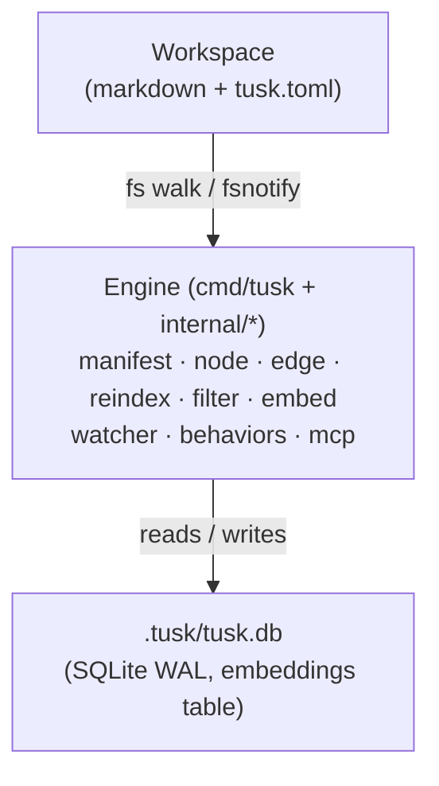

# Workspaces, nodes and the manifest

A Tusk workspace is just a directory:

```
my-brain/
├── tusk.toml                # workspace manifest (committed)
├── .tusk/                   # gitignored — local SQLite index
│   └── tusk.db
├── .gitignore
├── notes/
│   └── auth-rfc.md
├── tickets/
│   └── fix-login-bug.md
└── tags/
    └── auth.md
```

## Nodes are markdown files

Every `.md` file with a `type:` field in YAML frontmatter is a **node**. The file path (minus the extension) is the canonical **node id** — no separate id field.

```markdown
---
type: ticket
title: Fix login bug
status: active
priority: high
due: 2026-05-15
parent: tickets/auth-epic
blocks: [tickets/refactor-storage]
tags: [auth, security]
---

# Fix login bug

The bug occurs when users with SSO accounts hit the password reset flow.
See [[notes/auth-rfc]] for context.
```

- `type` is the only universally reserved key.
- Other frontmatter keys are either **properties** (string / int / date / enum / ref / list-of) or **edges** (declared in `tusk.toml`).
- `[[notes/auth-rfc]]` body wikilinks materialize as edges to that node id for any edge type declared with `wikilinks = true` (e.g. the `vault` pack's `references` edge). The Obsidian aliased form `[[notes/auth-rfc|the auth RFC]]` links to the same node id — the text after `|` is display only — and a `tusk node move` retargets the id while keeping the display text. A wikilink inside inline code or a code block is an example, not a link: it makes no edge, and a move leaves it as written.

### Folders of plain markdown

Markdown without a `type:` is not a node, so an existing Obsidian vault or `docs/` folder indexes as an empty graph. Set a default type to index it as it is:

```toml
[workspace]
name = "notes"
default-type = "note"
```

Every `.md` or `.mdx` file with no type of its own (no frontmatter, or frontmatter without `type:`) is then indexed as a `note`. The type must be declared under `[node-types]`; the `vault` pack declares `note`. An adopted file takes its title from `title:`, then from its first `# ` heading, then from its file name, and any frontmatter it has still applies. HTML pages still need their `tusk:type` meta, since untyped HTML is usually build output.

Tusk never adds a type to these files. Reindex leaves them as they are, and `tusk node modify` writes frontmatter only when the change sets a property, so editing the body of a plain file keeps it plain. Changing or removing `default-type` re-processes every file on the next reindex, and files it no longer covers leave the index.

`tusk init` sets this up when the folder already holds untyped markdown: it reports how many files it found, adds the `vault` pack, and writes `default-type = "note"`. Pass `--no-adopt` to keep those files out.

## Edges connect nodes

Edges are typed, declared in the manifest, and can be created two ways:

- **Frontmatter** — the natural place. `parent: tickets/auth-epic` declares a `parent` edge.
- **CLI / MCP** — `tusk edge add --type blocks --source tickets/a --target tickets/b`.

Edge declarations enforce legality (`from`/`to` types), cardinality, ordering, and optional `acyclic = true` (cycles are rejected at write time). A hand-edited file that breaks `from`/`to` or cardinality is still indexed, and `tusk doctor` reports the edge as an error.

## Pages name the files they describe

Technical pages name source files, in inline code or as links. Set `paths = true` on an edge type and tusk records, with its line, each inline-code span that is a workspace-relative path (`` `server/ledger/core/service.go` ``, or a bare `Makefile`) and each link or image destination (`[the service](../server/ledger/core/service.go)`, resolved against the page's folder), so a file can find the pages that describe it:

```toml
[edge-types.describes]
from  = ["technical"]   # which pages are scanned
paths = true
```

With no `to`, the edge type holds no node edges, so its frontmatter values are paths too. `describes: [server/ledger/core/service.go]` declares the path outright, with no heuristic involved.

```bash
# Which pages name this file (or a directory above it), and where?
tusk query 'names-path=server/ledger/core/service.go' --include paths

# Only through one edge type, when several set paths = true
tusk query 'names-path:describes=server/ledger/core/service.go'

# Every path one page names
tusk node get technical/ledger --include paths
```

The source tree can stay in `[workspace] ignore`: a path ref targets a path, not a node. `tusk doctor` warns with `path-missing` when a page names a path that has been renamed or deleted, and the Claude Code plugin (`tusk claude install`) reminds the agent of those pages right after it edits the file.

## The manifest defines the schema

`tusk.toml` is the contract between you and the engine. A minimal manifest:

```toml
[workspace]
name = "my-brain"
ignore = ["bin/", "node_modules/", "*.test"]

[embeddings]
provider = "ollama"
endpoint = "http://localhost:11434"
model    = "nomic-embed-text"
dim      = 768

[node-types.note]
description = "A free-form markdown note"
properties = []

[node-types.decision]
description = "A captured decision"
properties = [
    { name = "decided-at",  type = "date", required = true },
    { name = "status",      type = "enum", values = ["proposed", "accepted", "rejected", "superseded"] },
    { name = "supersedes",  type = "ref",  to = "decision" },
]

[edge-types.references]
description = "Implicit edge materialized from body wikilinks"
from        = ["*"]
to          = ["*"]
cardinality = "many-to-many"
inverse     = "referenced-by"
```

`ref` properties auto-materialize edge types of the same name — declaring `supersedes` as a `ref` to `decision` gives you a `supersedes` edge for free.

Conventions the schema can't express, like "product notes live under `docs/product/`", are declared as rules that `tusk doctor` checks. See [Rules and doctor](rules-and-doctor.md).

Edited `tusk.toml` while a daemon is running? `tusk reload` (or the `tusk_reload` MCP tool) re-reads and validates the manifest, hot-swaps the schema in place — no restart — and converges any sibling daemons via the `.tusk/manifest-epoch` sentinel. It then reindexes to re-validate your content against the new schema. Validation matches startup, so a reload lands the same state a restart would.

## Type packs (built-in templates)

Instead of declaring everything by hand, `tusk pack add <name>` splices a curated TOML block into your manifest:

| Pack | Adds |
|------|------|
| `vault` | `note`, `meeting`, `decision`; `references` (wikilinks) + `relates-to` |
| `tags` | `tag` node + `tagged` edge (with `tags: [a, b]` frontmatter shorthand) |
| `kanban` | `ticket` node with workflow-validated `status`; `parent` (WBS) + `blocks` edges |
| `dev` | `spec`, `plan`, `handoff`, `package` — dogfooding pack for tracking software projects |

Packs compose: add `vault` + `tags` + `kanban` and you have notes, decisions, tags, and a kanban workflow on top. `vault`, `tags` and `kanban` are compiled into tusk, so adding them by name works offline; `dev` installs by URL.

```bash
tusk pack add vault
tusk pack add tags
tusk pack add kanban
```

You can also load a pack from a URL or local file:

```bash
tusk pack add https://example.com/packs/research.toml
tusk pack add file://$PWD/my-pack.toml
```

## Indexing

The index lives in `.tusk/tusk.db` (SQLite + WAL). It is **derived state** — delete `.tusk/` and `tusk reindex` rebuilds it identically.

### One-shot reindex

```bash
tusk reindex
# Reindex done: 142 indexed, 0 removed, 3 skipped (2 not nodes)
```

`reindex` walks the workspace, parses every `.md`, validates frontmatter against the manifest, resolves refs + wikilinks into edges, and enqueues embeddings.

A skipped file is one reindex left out of the index. The `not nodes` count is plain markdown with no frontmatter or no `type:` (in a workspace without `default-type`), plus HTML with no `tusk:type`; these are fine and get no warning. Any other skip is a file reindex could not parse: it is logged as a warning and `tusk doctor` reports it.

### Live watcher

```bash
tusk watch
```

Runs fsnotify against the workspace and applies edits incrementally. Drains the embed queue in the background.

### What gets indexed

- Every `.md` file with a `type:` field, anywhere in the workspace, and every
  other `.md` file too when `[workspace] default-type` is set.
- Every `.html` / `.htm` file with a `<meta name="tusk:type">` tag — indexed
  over its **prose** (tags stripped, entities decoded), with `<meta name="tusk:*">`
  becoming typed node properties and `data-*` attributes captured as lenient
  signals under the reserved `data` key.
- Filtered through `.gitignore` + `[workspace] ignore` patterns.
- `.tusk/` and `.git/` are always ignored.

Off-schema content is **warned, not rejected** — a file with an unknown `type:`, a property violation, or an edge its edge type forbids still gets indexed (so it stays queryable) and surfaces in `tusk doctor`. The exception is a file reindex cannot parse at all (frontmatter that does not decode, say): it stays out of the index, and `tusk doctor` reports it as a `skipped-file` error with the parse error. Plain markdown with no frontmatter or no `type:` is not a node and is never reported.

## Architecture

Single Go binary, single SQLite index, single embedding provider (Ollama for now).



- **Filesystem > index, always.** The index is a cache; if it is stale, wedged, or corrupt, run `tusk reset` (or the `tusk_reset` MCP tool with `confirm: true`) to drop and rebuild it from your files. The markdown files are the source of truth, so nothing is lost.
- **Stateless across machines.** Clone the vault, reindex, get an identical brain.
- **Single-writer, many-readers.** SQLite WAL + a workspace-wide advisory lock so `tusk mcp` and one-shot CLI calls coexist.

Product vision and design principles live in [`PRODUCT.md`](../../PRODUCT.md). Per-package notes live in [`docs/packages/`](../packages/).
