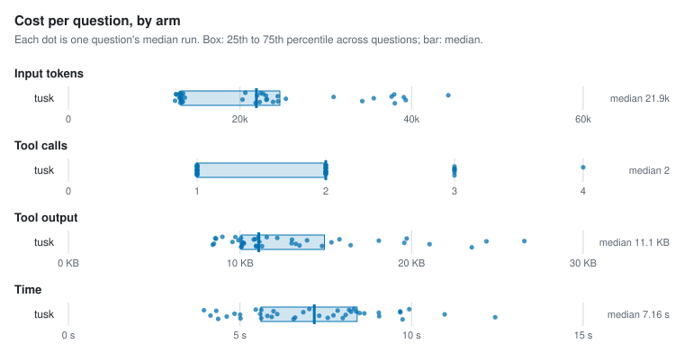
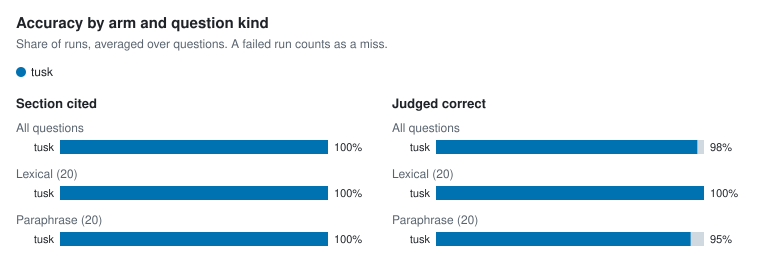

# Agent retrieval benchmark

- Corpus: 35 markdown files, 154 sections (docs/packages)
- Questions: 40, 3 repetitions per arm
- Agent model: claude-sonnet-5-5; judge: haiku
- tusk v1.0.0-dev (5f303b5, modified); Claude Code 2.1.300; 4 concurrent runs; 2026-10-15

## Per arm

Each figure is the median over questions of that question's median run, with the 25th to 75th percentile in brackets.

| Arm | Input tokens | Tool calls | Tool output | Time | Cost | Section cited | Judged correct | Runs (failed) |
| --- | --- | --- | --- | --- | --- | --- | --- | --- |
| tusk | 21,910 [13,114–24,656] | 2 [1–2] | 11.1 KB [10.1 KB–14.9 KB] | 7.2 s [5.6 s–8.4 s] | $0.032 [$0.029–$0.041] | 100% | 98% | 120 (0) |

## Per question

| Question | Kind | Arm | Input tokens | Tool calls | Tool output | Time | Section cited | Judged correct | Failed |
| --- | --- | --- | --- | --- | --- | --- | --- | --- | --- |
| `address-table-cell` | lexical | tusk | 20,618 | 2 | 9.0 KB | 8.3 s | 100% | 100% | 0 |
| `alias-doctor-exit` | lexical | tusk | 13,153 | 1 | 10.2 KB | 4.1 s | 100% | 100% | 0 |
| `asset-route-symlink` | lexical | tusk | 44,271 | 4 | 15.8 KB | 9.7 s | 100% | 100% | 0 |
| `clones-same-mentions` | paraphrase | tusk | 23,857 | 2 | 14.8 KB | 8.0 s | 100% | 100% | 0 |
| `csp-inline-style` | lexical | tusk | 12,980 | 1 | 9.6 KB | 5.6 s | 100% | 100% | 0 |
| `filter-literal-asterisk` | paraphrase | tusk | 12,965 | 1 | 10.1 KB | 5.6 s | 100% | 100% | 0 |
| `fresh-clone-health` | paraphrase | tusk | 13,120 | 1 | 10.1 KB | 4.6 s | 100% | 100% | 0 |
| `hand-edited-state-skip` | paraphrase | tusk | 24,398 | 2 | 13.9 KB | 9.7 s | 100% | 67% | 0 |
| `hierarchy-default-twice` | lexical | tusk | 21,821 | 1 | 10.1 KB | 6.6 s | 100% | 100% | 0 |
| `identifier-not-path` | lexical | tusk | 25,347 | 2 | 19.6 KB | 8.1 s | 100% | 100% | 0 |
| `ignore-negation` | lexical | tusk | 12,627 | 1 | 8.6 KB | 4.3 s | 100% | 100% | 0 |
| `incoming-links-once` | paraphrase | tusk | 24,426 | 2 | 13.5 KB | 6.6 s | 100% | 100% | 0 |
| `link-case-reprocess` | lexical | tusk | 39,097 | 3 | 24.4 KB | 8.6 s | 100% | 100% | 0 |
| `lone-carriage-return-lines` | paraphrase | tusk | 22,407 | 2 | 11.6 KB | 9.9 s | 100% | 100% | 0 |
| `manifest-epoch-format` | lexical | tusk | 23,066 | 2 | 13.3 KB | 5.8 s | 100% | 100% | 0 |
| `meaning-based-positions` | paraphrase | tusk | 23,025 | 2 | 13.0 KB | 8.2 s | 100% | 100% | 0 |
| `move-note-name-links` | paraphrase | tusk | 13,238 | 1 | 11.0 KB | 5.0 s | 100% | 100% | 0 |
| `names-path-directory` | lexical | tusk | 35,592 | 3 | 15.3 KB | 11.0 s | 100% | 100% | 0 |
| `path-missing-severity` | lexical | tusk | 12,523 | 1 | 8.6 KB | 4.0 s | 100% | 100% | 0 |
| `plugin-check-ci` | lexical | tusk | 12,435 | 1 | 8.4 KB | 5.9 s | 100% | 100% | 0 |
| `query-takes-lock` | lexical | tusk | 37,670 | 3 | 18.1 KB | 9.0 s | 100% | 100% | 0 |
| `rebuild-without-ollama` | paraphrase | tusk | 38,044 | 3 | 23.5 KB | 9.7 s | 100% | 100% | 0 |
| `reload-parse-error` | lexical | tusk | 23,142 | 2 | 13.0 KB | 7.7 s | 100% | 100% | 0 |
| `renamed-heading-ids` | paraphrase | tusk | 13,188 | 1 | 10.9 KB | 6.0 s | 100% | 100% | 0 |
| `repeat-edit-reminder` | paraphrase | tusk | 13,341 | 1 | 10.9 KB | 7.6 s | 100% | 100% | 0 |
| `same-paragraph-twice` | paraphrase | tusk | 13,576 | 1 | 11.1 KB | 4.8 s | 100% | 100% | 0 |
| `schema-migrate-in-place` | lexical | tusk | 13,375 | 1 | 11.1 KB | 5.5 s | 100% | 100% | 0 |
| `second-condition-after-traversal` | paraphrase | tusk | 39,323 | 3 | 21.0 KB | 9.1 s | 100% | 100% | 0 |
| `session-summary-concurrency` | paraphrase | tusk | 13,045 | 1 | 9.9 KB | 6.8 s | 100% | 100% | 0 |
| `short-claim-window` | paraphrase | tusk | 13,026 | 1 | 10.1 KB | 4.4 s | 100% | 100% | 0 |
| `sibling-notices-rebuild` | paraphrase | tusk | 13,098 | 1 | 10.2 KB | 5.0 s | 100% | 100% | 0 |
| `slow-browser-tab` | paraphrase | tusk | 37,967 | 3 | 19.7 KB | 7.8 s | 100% | 100% | 0 |
| `swap-wait-forever` | paraphrase | tusk | 34,253 | 2 | 16.4 KB | 12.4 s | 100% | 100% | 0 |
| `unquoted-frontmatter-wikilink` | lexical | tusk | 30,908 | 2 | 26.6 KB | 8.5 s | 100% | 100% | 0 |
| `update-cosign` | lexical | tusk | 13,057 | 1 | 9.7 KB | 7.0 s | 100% | 100% | 0 |
| `update-install-method` | lexical | tusk | 20,296 | 2 | 8.5 KB | 7.3 s | 100% | 100% | 0 |
| `updater-any-string` | paraphrase | tusk | 21,999 | 2 | 10.8 KB | 8.4 s | 100% | 100% | 0 |
| `vault-pack-offline` | lexical | tusk | 22,289 | 2 | 11.3 KB | 5.6 s | 100% | 100% | 0 |
| `wikilink-in-code-fence` | lexical | tusk | 12,997 | 1 | 10.1 KB | 6.1 s | 100% | 100% | 0 |
| `wipe-fails-partway` | paraphrase | tusk | 22,697 | 2 | 12.2 KB | 8.2 s | 100% | 33% | 0 |

## Charts

<picture>
  <source media="(prefers-color-scheme: dark)" srcset="charts/per-arm-dark.svg">
  
</picture>

<picture>
  <source media="(prefers-color-scheme: dark)" srcset="charts/accuracy-dark.svg">
  
</picture>

