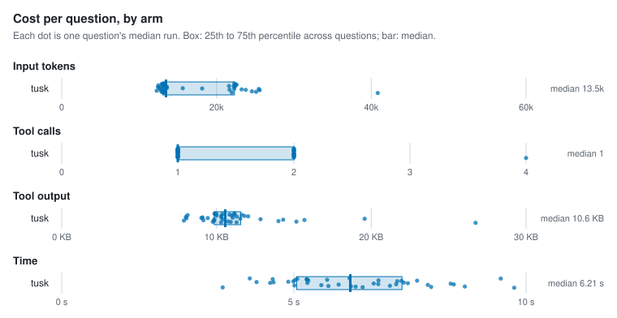
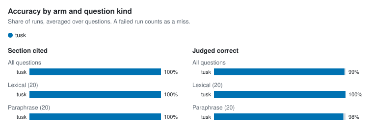

# Agent retrieval benchmark

- Corpus: 35 markdown files, 154 sections (docs/packages)
- Questions: 40, 3 repetitions per arm
- Agent model: claude-sonnet-5-5; judge: haiku
- tusk v1.0.0-dev (5f303b5, modified); Claude Code 2.1.300; 4 concurrent runs; 2026-10-15

## Per arm

Each figure is the median over questions of that question's median run, with the 25th to 75th percentile in brackets.

| Arm | Input tokens | Tool calls | Tool output | Time | Cost | Section cited | Judged correct | Runs (failed) |
| --- | --- | --- | --- | --- | --- | --- | --- | --- |
| tusk | 13,473 [13,062–22,319] | 1 [1–2] | 10.6 KB [9.9 KB–11.6 KB] | 6.2 s [5.1 s–7.3 s] | $0.030 [$0.028–$0.035] | 100% | 99% | 120 (0) |

## Per question

| Question | Kind | Arm | Input tokens | Tool calls | Tool output | Time | Section cited | Judged correct | Failed |
| --- | --- | --- | --- | --- | --- | --- | --- | --- | --- |
| `address-table-cell` | lexical | tusk | 22,300 | 2 | 11.2 KB | 6.2 s | 100% | 100% | 0 |
| `alias-doctor-exit` | lexical | tusk | 13,046 | 1 | 9.9 KB | 7.2 s | 100% | 100% | 0 |
| `asset-route-symlink` | lexical | tusk | 13,080 | 1 | 10.0 KB | 5.3 s | 100% | 100% | 0 |
| `clones-same-mentions` | paraphrase | tusk | 25,126 | 2 | 15.2 KB | 8.7 s | 100% | 100% | 0 |
| `csp-inline-style` | lexical | tusk | 12,664 | 1 | 9.0 KB | 4.5 s | 100% | 100% | 0 |
| `filter-literal-asterisk` | paraphrase | tusk | 12,972 | 1 | 9.9 KB | 4.5 s | 100% | 100% | 0 |
| `fresh-clone-health` | paraphrase | tusk | 12,798 | 1 | 9.2 KB | 5.6 s | 100% | 100% | 0 |
| `hand-edited-state-skip` | paraphrase | tusk | 13,585 | 1 | 11.3 KB | 5.0 s | 100% | 100% | 0 |
| `hierarchy-default-twice` | lexical | tusk | 13,145 | 1 | 10.3 KB | 3.5 s | 100% | 100% | 0 |
| `identifier-not-path` | lexical | tusk | 25,465 | 2 | 19.6 KB | 8.4 s | 100% | 100% | 0 |
| `ignore-negation` | lexical | tusk | 12,494 | 1 | 8.1 KB | 5.0 s | 100% | 100% | 0 |
| `incoming-links-once` | paraphrase | tusk | 24,578 | 2 | 14.0 KB | 5.7 s | 100% | 100% | 0 |
| `link-case-reprocess` | lexical | tusk | 12,676 | 1 | 9.1 KB | 4.6 s | 100% | 100% | 0 |
| `lone-carriage-return-lines` | paraphrase | tusk | 12,952 | 1 | 10.0 KB | 9.5 s | 100% | 100% | 0 |
| `manifest-epoch-format` | lexical | tusk | 23,783 | 2 | 14.3 KB | 6.0 s | 100% | 100% | 0 |
| `meaning-based-positions` | paraphrase | tusk | 22,223 | 2 | 11.8 KB | 7.3 s | 100% | 100% | 0 |
| `move-note-name-links` | paraphrase | tusk | 13,207 | 1 | 10.9 KB | 8.0 s | 100% | 100% | 0 |
| `names-path-directory` | lexical | tusk | 18,143 | 2 | 8.1 KB | 7.5 s | 100% | 100% | 0 |
| `path-missing-severity` | lexical | tusk | 13,139 | 1 | 10.8 KB | 5.3 s | 100% | 100% | 0 |
| `plugin-check-ci` | lexical | tusk | 12,269 | 1 | 7.9 KB | 5.0 s | 100% | 100% | 0 |
| `query-takes-lock` | lexical | tusk | 12,426 | 1 | 8.0 KB | 4.9 s | 100% | 100% | 0 |
| `rebuild-without-ollama` | paraphrase | tusk | 40,839 | 4 | 26.7 KB | 9.7 s | 100% | 100% | 0 |
| `reload-parse-error` | lexical | tusk | 23,241 | 2 | 12.8 KB | 6.8 s | 100% | 100% | 0 |
| `renamed-heading-ids` | paraphrase | tusk | 13,185 | 1 | 11.0 KB | 6.8 s | 100% | 100% | 0 |
| `repeat-edit-reminder` | paraphrase | tusk | 13,367 | 1 | 10.7 KB | 6.2 s | 100% | 100% | 0 |
| `same-paragraph-twice` | paraphrase | tusk | 13,579 | 1 | 11.0 KB | 7.4 s | 100% | 100% | 0 |
| `schema-migrate-in-place` | lexical | tusk | 13,188 | 1 | 10.4 KB | 5.1 s | 100% | 100% | 0 |
| `second-condition-after-traversal` | paraphrase | tusk | 25,573 | 2 | 15.7 KB | 7.9 s | 100% | 100% | 0 |
| `session-summary-concurrency` | paraphrase | tusk | 22,376 | 2 | 12.0 KB | 7.2 s | 100% | 100% | 0 |
| `short-claim-window` | paraphrase | tusk | 21,989 | 2 | 11.3 KB | 6.5 s | 100% | 100% | 0 |
| `sibling-notices-rebuild` | paraphrase | tusk | 22,291 | 2 | 11.5 KB | 6.7 s | 100% | 100% | 0 |
| `slow-browser-tab` | paraphrase | tusk | 22,528 | 2 | 11.6 KB | 5.7 s | 100% | 100% | 0 |
| `swap-wait-forever` | paraphrase | tusk | 13,067 | 1 | 9.8 KB | 7.1 s | 100% | 100% | 0 |
| `unquoted-frontmatter-wikilink` | lexical | tusk | 13,204 | 1 | 10.3 KB | 4.2 s | 100% | 100% | 0 |
| `update-cosign` | lexical | tusk | 13,130 | 1 | 9.9 KB | 4.1 s | 100% | 100% | 0 |
| `update-install-method` | lexical | tusk | 21,678 | 2 | 10.4 KB | 8.4 s | 100% | 100% | 0 |
| `updater-any-string` | paraphrase | tusk | 21,624 | 2 | 10.3 KB | 7.7 s | 100% | 100% | 0 |
| `vault-pack-offline` | lexical | tusk | 12,930 | 1 | 9.8 KB | 6.3 s | 100% | 100% | 0 |
| `wikilink-in-code-fence` | lexical | tusk | 15,641 | 1 | 9.4 KB | 5.3 s | 100% | 100% | 0 |
| `wipe-fails-partway` | paraphrase | tusk | 22,577 | 2 | 11.2 KB | 5.3 s | 100% | 67% | 0 |

## Charts

<picture>
  <source media="(prefers-color-scheme: dark)" srcset="charts/per-arm-dark.svg">
  
</picture>

<picture>
  <source media="(prefers-color-scheme: dark)" srcset="charts/accuracy-dark.svg">
  
</picture>

