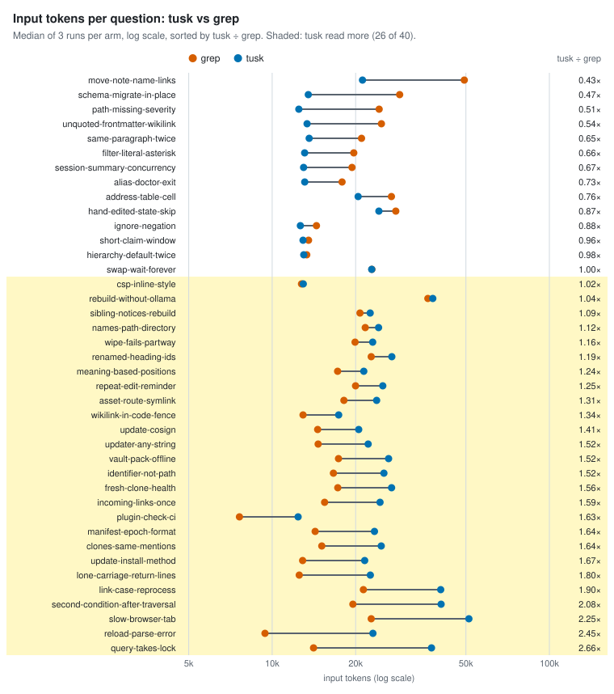
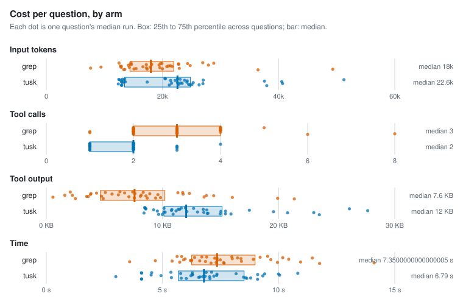

# Agent retrieval benchmark

- Corpus: 34 markdown files, 151 sections (docs/packages)
- Questions: 40, 3 repetitions per arm
- Agent model: claude-sonnet-5-5; judge: haiku
- tusk v1.0.0-dev (9e6e5b3); Claude Code 2.1.300; 4 concurrent runs; 2026-10-15

## Per arm

Each figure is the median over questions of that question's median run, with the 25th to 75th percentile in brackets.

| Arm | Input tokens | Tool calls | Tool output | Time | Cost | Section cited | Judged correct | Runs (failed) |
| --- | --- | --- | --- | --- | --- | --- | --- | --- |
| grep | 18,012 [14,406–21,943] | 3 [2–4] | 7.6 KB [4.6 KB–10.2 KB] | 7.3 s [6.3 s–9.0 s] | $0.025 [$0.018–$0.031] | 95% | 99% | 120 (0) |
| tusk | 22,588 [13,464–24,826] | 2 [1–2] | 12.0 KB [10.1 KB–15.1 KB] | 6.8 s [5.7 s–8.5 s] | $0.036 [$0.029–$0.040] | 100% | 100% | 120 (0) |

## tusk vs grep, paired by question

A ratio below 1 means tusk used less than grep on the same question.

| Metric | Median ratio (tusk / grep) | 95% CI | Questions where tusk used less |
| --- | --- | --- | --- |
| Input tokens | 1.21 | 1.01–1.52 | 14 of 40 |
| Tool output | 1.64 | 1.35–2.14 | 5 of 40 |
| Time | 0.93 | 0.78–1.03 | 25 of 40 |
| Cost | 1.48 | 1.29–1.78 | 4 of 40 |

| Metric | Median difference (tusk − grep) | 95% CI | Questions where tusk used fewer |
| --- | --- | --- | --- |
| Tool calls | -1 | -1 to -0.5 | 26 of 40 |

| Accuracy | grep | tusk | Difference | 95% CI |
| --- | --- | --- | --- | --- |
| Section cited | 95% | 100% | +5 pp | +1 pp to +10 pp |
| Judged correct | 99% | 100% | +1 pp | +0 pp to +2 pp |

### By question kind

| Kind | Questions | Arm | Input tokens | Tool calls | Section cited | Judged correct |
| --- | --- | --- | --- | --- | --- | --- |
| lexical | 20 | grep | 15,614 | 2 | 98% | 98% |
| lexical | 20 | tusk | 20,471 | 2 | 100% | 100% |
| paraphrase | 20 | grep | 19,806 | 3 | 92% | 100% |
| paraphrase | 20 | tusk | 22,955 | 2 | 100% | 100% |

### Where tusk lost

26 of 40 questions: tusk read more input tokens than grep, or was judged correct less often.

| Question | Kind | Input tokens (grep → tusk) | Tool calls (grep → tusk) | Judged correct (grep / tusk) |
| --- | --- | --- | --- | --- |
| `asset-route-symlink` How does the `/api/read/asset` route stop a symlink from exposing files under `.tusk` or `.git`? | lexical | 18,150 → 23,816 | 3 → 2 | 100% / 100% |
| `clones-same-mentions` Two people clone the same vault on different machines with different files checked out. Will indexing record the same file mentions for both? | paraphrase | 15,103 → 24,746 | 3 → 2 | 100% / 100% |
| `csp-inline-style` Why does the web app's CSP allow `'unsafe-inline'` styles but never inline scripts? | lexical | 12,756 → 12,948 | 3 → 1 | 100% / 100% |
| `fresh-clone-health` Right after cloning a repo, before anything has been indexed, what does the health check report? | paraphrase | 17,241 → 26,965 | 3 → 2 | 100% / 100% |
| `identifier-not-path` Is an inline code span like `ExtractWikilinks` recorded as a path ref? | lexical | 16,633 → 25,303 | 2 → 2 | 100% / 100% |
| `incoming-links-once` When several parts of a single page all reference the same note, does the reader's incoming-links list show that page once or once per part? | paraphrase | 15,457 → 24,502 | 2 → 2 | 100% / 100% |
| `link-case-reprocess` Why does changing `[workspace] link-case` force a full re-process of the vault? | lexical | 21,338 → 40,555 | 4 → 3 | 67% / 100% |
| `lone-carriage-return-lines` A file uses bare carriage returns as line breaks, like old Mac files. With default settings, will tusk's reported line numbers match what most editors show? | paraphrase | 12,523 → 22,600 | 2 → 2 | 100% / 100% |
| `manifest-epoch-format` What is the on-disk format of `.tusk/manifest-epoch`, and can it be changed? | lexical | 14,296 → 23,392 | 2 → 2 | 100% / 100% |
| `meaning-based-positions` When the 3D view arranges notes by meaning instead of by links, how are their positions computed? | paraphrase | 17,222 → 21,402 | 2 → 2 | 100% / 100% |
| `names-path-directory` Does `names-path=server/ledger/core.go` also match a page that only names the `server/ledger` directory? | lexical | 21,668 → 24,208 | 2 → 3 | 100% / 100% |
| `plugin-check-ci` Why doesn't `make claude-plugin-check` run in CI? | lexical | 7,622 → 12,402 | 1 → 1 | 100% / 100% |
| `query-takes-lock` Does `tusk query` take the workspace lock? | lexical | 14,104 → 37,564 | 2 → 2 | 100% / 100% |
| `rebuild-without-ollama` What happens when you rebuild the index while Ollama isn't running? | paraphrase | 36,452 → 37,966 | 6 → 3 | 100% / 100% |
| `reload-parse-error` What happens if `tusk_reload` hits a TOML parse error in tusk.toml? | lexical | 9,420 → 23,094 | 1 → 2 | 100% / 100% |
| `renamed-heading-ids` If I rename a heading in a note, do the ids of that section and the sections under it change? | paraphrase | 22,777 → 27,025 | 2 → 2 | 100% / 100% |
| `repeat-edit-reminder` If an agent edits the same source file ten times in one session, does tusk add the list of docs that mention that file after every edit? | paraphrase | 19,995 → 25,068 | 3 → 2 | 100% / 100% |
| `second-condition-after-traversal` In a filter that follows links out to other notes and then adds a second condition after it, does the second condition apply to the linked notes or to the starting notes? | paraphrase | 19,557 → 40,677 | 4 → 3 | 100% / 100% |
| `sibling-notices-rebuild` When one tusk process deletes and rebuilds the index database, how do other tusk servers already running on the same vault find out? | paraphrase | 20,748 → 22,577 | 3 → 2 | 100% / 100% |
| `slow-browser-tab` What happens to live updates for a browser tab that reads too slowly and falls behind? | paraphrase | 22,768 → 51,243 | 3 → 4 | 100% / 100% |
| `update-cosign` Does `tusk update` verify the cosign signature on a release? | lexical | 14,596 → 20,521 | 3 → 2 | 100% / 100% |
| `update-install-method` How does `tusk update` tell a `go install` binary apart from a local `make build`, given both report a -dev version? | lexical | 12,877 → 21,566 | 2 → 2 | 100% / 100% |
| `updater-any-string` What could go wrong if the self-updater accepted any string as the release to install? | paraphrase | 14,649 → 22,196 | 2 → 2 | 100% / 100% |
| `vault-pack-offline` Can `tusk init` add the built-in vault pack without network access? | lexical | 17,355 → 26,311 | 3 → 2 | 100% / 100% |
| `wikilink-in-code-fence` Does a `[[wikilink]]` written inside a fenced code block create an edge? | lexical | 12,921 → 17,373 | 2 → 1 | 100% / 100% |
| `wipe-fails-partway` If wiping and recreating the search database fails partway through, will other running servers switch over to the half-finished copy? | paraphrase | 19,908 → 23,049 | 2 → 2 | 100% / 100% |

## Per question

| Question | Kind | Arm | Input tokens | Tool calls | Tool output | Time | Section cited | Judged correct | Failed |
| --- | --- | --- | --- | --- | --- | --- | --- | --- | --- |
| `address-table-cell` | lexical | grep | 26,933 | 4 | 6.3 KB | 9.5 s | 100% | 100% | 0 |
| `address-table-cell` | lexical | tusk | 20,421 | 2 | 8.5 KB | 7.1 s | 100% | 100% | 0 |
| `alias-doctor-exit` | lexical | grep | 17,874 | 2 | 8.1 KB | 6.6 s | 67% | 100% | 0 |
| `alias-doctor-exit` | lexical | tusk | 13,105 | 1 | 10.2 KB | 3.0 s | 100% | 100% | 0 |
| `asset-route-symlink` | lexical | grep | 18,150 | 3 | 3.8 KB | 11.5 s | 100% | 100% | 0 |
| `asset-route-symlink` | lexical | tusk | 23,816 | 2 | 13.5 KB | 9.4 s | 100% | 100% | 0 |
| `clones-same-mentions` | paraphrase | grep | 15,103 | 3 | 9.4 KB | 7.3 s | 100% | 100% | 0 |
| `clones-same-mentions` | paraphrase | tusk | 24,746 | 2 | 15.4 KB | 8.6 s | 100% | 100% | 0 |
| `csp-inline-style` | lexical | grep | 12,756 | 3 | 1.6 KB | 5.9 s | 100% | 100% | 0 |
| `csp-inline-style` | lexical | tusk | 12,948 | 1 | 9.6 KB | 4.9 s | 100% | 100% | 0 |
| `filter-literal-asterisk` | paraphrase | grep | 19,703 | 4 | 5.1 KB | 6.7 s | 100% | 100% | 0 |
| `filter-literal-asterisk` | paraphrase | tusk | 13,095 | 1 | 10.1 KB | 4.1 s | 100% | 100% | 0 |
| `fresh-clone-health` | paraphrase | grep | 17,241 | 3 | 13.6 KB | 6.9 s | 100% | 100% | 0 |
| `fresh-clone-health` | paraphrase | tusk | 26,965 | 2 | 20.8 KB | 6.6 s | 100% | 100% | 0 |
| `hand-edited-state-skip` | paraphrase | grep | 27,921 | 3 | 11.8 KB | 8.0 s | 100% | 100% | 0 |
| `hand-edited-state-skip` | paraphrase | tusk | 24,262 | 2 | 13.8 KB | 9.1 s | 100% | 100% | 0 |
| `hierarchy-default-twice` | lexical | grep | 13,325 | 2 | 2.5 KB | 7.7 s | 100% | 100% | 0 |
| `hierarchy-default-twice` | lexical | tusk | 13,003 | 1 | 10.0 KB | 4.1 s | 100% | 100% | 0 |
| `identifier-not-path` | lexical | grep | 16,633 | 2 | 8.6 KB | 6.2 s | 100% | 100% | 0 |
| `identifier-not-path` | lexical | tusk | 25,303 | 2 | 19.6 KB | 6.8 s | 100% | 100% | 0 |
| `ignore-negation` | lexical | grep | 14,442 | 2 | 4.3 KB | 10.2 s | 100% | 100% | 0 |
| `ignore-negation` | lexical | tusk | 12,643 | 1 | 8.6 KB | 5.8 s | 100% | 100% | 0 |
| `incoming-links-once` | paraphrase | grep | 15,457 | 2 | 9.8 KB | 5.7 s | 100% | 100% | 0 |
| `incoming-links-once` | paraphrase | tusk | 24,502 | 2 | 13.9 KB | 8.8 s | 100% | 100% | 0 |
| `link-case-reprocess` | lexical | grep | 21,338 | 4 | 6.2 KB | 8.9 s | 100% | 67% | 0 |
| `link-case-reprocess` | lexical | tusk | 40,555 | 3 | 27.7 KB | 10.0 s | 100% | 100% | 0 |
| `lone-carriage-return-lines` | paraphrase | grep | 12,523 | 2 | 2.1 KB | 5.8 s | 100% | 100% | 0 |
| `lone-carriage-return-lines` | paraphrase | tusk | 22,600 | 2 | 12.0 KB | 6.9 s | 100% | 100% | 0 |
| `manifest-epoch-format` | lexical | grep | 14,296 | 2 | 3.6 KB | 5.4 s | 100% | 100% | 0 |
| `manifest-epoch-format` | lexical | tusk | 23,392 | 2 | 13.6 KB | 6.6 s | 100% | 100% | 0 |
| `meaning-based-positions` | paraphrase | grep | 17,222 | 2 | 8.9 KB | 7.3 s | 100% | 100% | 0 |
| `meaning-based-positions` | paraphrase | tusk | 21,402 | 2 | 10.8 KB | 7.3 s | 100% | 100% | 0 |
| `move-note-name-links` | paraphrase | grep | 49,318 | 8 | 19.9 KB | 14.1 s | 67% | 100% | 0 |
| `move-note-name-links` | paraphrase | tusk | 21,181 | 2 | 10.9 KB | 7.0 s | 100% | 100% | 0 |
| `names-path-directory` | lexical | grep | 21,668 | 2 | 13.8 KB | 6.3 s | 100% | 100% | 0 |
| `names-path-directory` | lexical | tusk | 24,208 | 3 | 15.0 KB | 9.3 s | 100% | 100% | 0 |
| `path-missing-severity` | lexical | grep | 24,320 | 4 | 11.3 KB | 9.2 s | 100% | 100% | 0 |
| `path-missing-severity` | lexical | tusk | 12,480 | 1 | 8.6 KB | 4.1 s | 100% | 100% | 0 |
| `plugin-check-ci` | lexical | grep | 7,622 | 1 | 0.6 KB | 3.6 s | 100% | 100% | 0 |
| `plugin-check-ci` | lexical | tusk | 12,402 | 1 | 8.4 KB | 5.4 s | 100% | 100% | 0 |
| `query-takes-lock` | lexical | grep | 14,104 | 2 | 3.8 KB | 6.0 s | 100% | 100% | 0 |
| `query-takes-lock` | lexical | tusk | 37,564 | 2 | 17.5 KB | 6.3 s | 100% | 100% | 0 |
| `rebuild-without-ollama` | paraphrase | grep | 36,452 | 6 | 21.4 KB | 11.8 s | 67% | 100% | 0 |
| `rebuild-without-ollama` | paraphrase | tusk | 37,966 | 3 | 23.5 KB | 9.1 s | 100% | 100% | 0 |
| `reload-parse-error` | lexical | grep | 9,420 | 1 | 4.8 KB | 4.7 s | 100% | 100% | 0 |
| `reload-parse-error` | lexical | tusk | 23,094 | 2 | 13.0 KB | 6.7 s | 100% | 100% | 0 |
| `renamed-heading-ids` | paraphrase | grep | 22,777 | 2 | 12.3 KB | 8.2 s | 100% | 100% | 0 |
| `renamed-heading-ids` | paraphrase | tusk | 27,025 | 2 | 11.4 KB | 8.2 s | 100% | 100% | 0 |
| `repeat-edit-reminder` | paraphrase | grep | 19,995 | 3 | 7.6 KB | 9.9 s | 100% | 100% | 0 |
| `repeat-edit-reminder` | paraphrase | tusk | 25,068 | 2 | 15.0 KB | 5.8 s | 100% | 100% | 0 |
| `same-paragraph-twice` | paraphrase | grep | 21,011 | 4 | 8.2 KB | 9.7 s | 100% | 100% | 0 |
| `same-paragraph-twice` | paraphrase | tusk | 13,600 | 1 | 11.2 KB | 7.3 s | 100% | 100% | 0 |
| `schema-migrate-in-place` | lexical | grep | 28,838 | 5 | 8.3 KB | 8.0 s | 100% | 100% | 0 |
| `schema-migrate-in-place` | lexical | tusk | 13,499 | 1 | 11.6 KB | 4.5 s | 100% | 100% | 0 |
| `second-condition-after-traversal` | paraphrase | grep | 19,557 | 4 | 7.1 KB | 8.4 s | 100% | 100% | 0 |
| `second-condition-after-traversal` | paraphrase | tusk | 40,677 | 3 | 23.0 KB | 8.5 s | 100% | 100% | 0 |
| `session-summary-concurrency` | paraphrase | grep | 19,412 | 4 | 5.7 KB | 8.4 s | 100% | 100% | 0 |
| `session-summary-concurrency` | paraphrase | tusk | 12,988 | 1 | 9.2 KB | 6.3 s | 100% | 100% | 0 |
| `short-claim-window` | paraphrase | grep | 13,523 | 2 | 4.9 KB | 7.1 s | 100% | 100% | 0 |
| `short-claim-window` | paraphrase | tusk | 12,919 | 1 | 9.7 KB | 4.1 s | 100% | 100% | 0 |
| `sibling-notices-rebuild` | paraphrase | grep | 20,748 | 3 | 14.4 KB | 7.4 s | 33% | 100% | 0 |
| `sibling-notices-rebuild` | paraphrase | tusk | 22,577 | 2 | 12.1 KB | 7.2 s | 100% | 100% | 0 |
| `slow-browser-tab` | paraphrase | grep | 22,768 | 3 | 6.7 KB | 6.4 s | 67% | 100% | 0 |
| `slow-browser-tab` | paraphrase | tusk | 51,243 | 4 | 26.1 KB | 10.8 s | 100% | 100% | 0 |
| `swap-wait-forever` | paraphrase | grep | 22,895 | 3 | 16.0 KB | 10.9 s | 100% | 100% | 0 |
| `swap-wait-forever` | paraphrase | tusk | 22,861 | 2 | 13.9 KB | 8.6 s | 100% | 100% | 0 |
| `unquoted-frontmatter-wikilink` | lexical | grep | 24,776 | 4 | 9.6 KB | 10.4 s | 100% | 100% | 0 |
| `unquoted-frontmatter-wikilink` | lexical | tusk | 13,361 | 1 | 10.8 KB | 4.5 s | 100% | 100% | 0 |
| `update-cosign` | lexical | grep | 14,596 | 3 | 7.4 KB | 5.6 s | 100% | 100% | 0 |
| `update-cosign` | lexical | tusk | 20,521 | 2 | 8.5 KB | 5.4 s | 100% | 100% | 0 |
| `update-install-method` | lexical | grep | 12,877 | 2 | 3.5 KB | 6.2 s | 100% | 100% | 0 |
| `update-install-method` | lexical | tusk | 21,566 | 2 | 10.1 KB | 7.0 s | 100% | 100% | 0 |
| `updater-any-string` | paraphrase | grep | 14,649 | 2 | 7.6 KB | 7.2 s | 100% | 100% | 0 |
| `updater-any-string` | paraphrase | tusk | 22,196 | 2 | 11.5 KB | 10.0 s | 100% | 100% | 0 |
| `vault-pack-offline` | lexical | grep | 17,355 | 3 | 8.7 KB | 7.6 s | 100% | 100% | 0 |
| `vault-pack-offline` | lexical | tusk | 26,311 | 2 | 15.9 KB | 6.0 s | 100% | 100% | 0 |
| `wikilink-in-code-fence` | lexical | grep | 12,921 | 2 | 2.2 KB | 7.5 s | 100% | 100% | 0 |
| `wikilink-in-code-fence` | lexical | tusk | 17,373 | 1 | 15.4 KB | 6.2 s | 100% | 100% | 0 |
| `wipe-fails-partway` | paraphrase | grep | 19,908 | 2 | 11.7 KB | 6.9 s | 100% | 100% | 0 |
| `wipe-fails-partway` | paraphrase | tusk | 23,049 | 2 | 12.7 KB | 6.3 s | 100% | 100% | 0 |

## Charts

<picture>
  <source media="(prefers-color-scheme: dark)" srcset="charts/tokens-tusk-vs-grep-dark.svg">
  
</picture>

<picture>
  <source media="(prefers-color-scheme: dark)" srcset="charts/per-arm-dark.svg">
  
</picture>

<picture>
  <source media="(prefers-color-scheme: dark)" srcset="charts/accuracy-dark.svg">
  
</picture>

