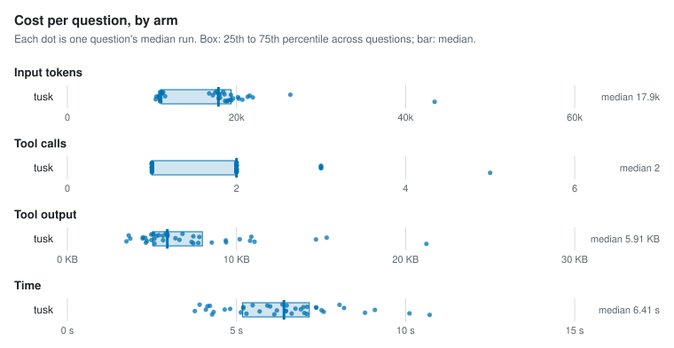
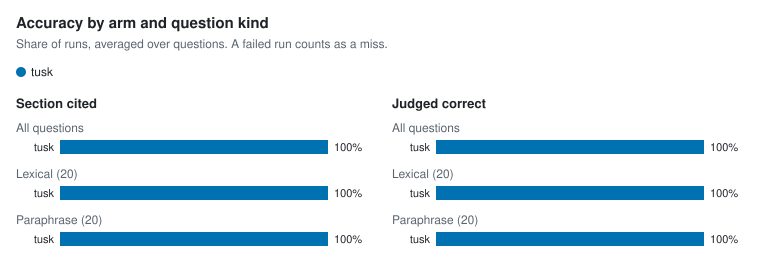

# Agent retrieval benchmark

- Corpus: 35 markdown files, 154 sections (docs/packages)
- Questions: 40, 3 repetitions per arm
- Agent model: claude-sonnet-5-5; judge: haiku
- tusk v1.0.0-dev; Claude Code 2.1.301; 4 concurrent runs; 2026-10-15

## Per arm

Each figure is the median over questions of that question's median run, with the 25th to 75th percentile in brackets.

| Arm | Input tokens | Tool calls | Tool output | Time | Cost | Section cited | Judged correct | Runs (failed) |
| --- | --- | --- | --- | --- | --- | --- | --- | --- |
| tusk | 17,868 [11,110–19,358] | 2 [1–2] | 5.9 KB [5.0 KB–8.0 KB] | 6.4 s [5.2 s–7.2 s] | $0.025 [$0.020–$0.029] | 100% | 100% | 120 (0) |

## Per question

| Question | Kind | Arm | Input tokens | Tool calls | Tool output | Time | Section cited | Judged correct | Failed |
| --- | --- | --- | --- | --- | --- | --- | --- | --- | --- |
| `address-table-cell` | lexical | tusk | 17,672 | 2 | 5.8 KB | 6.4 s | 100% | 100% | 0 |
| `alias-doctor-exit` | lexical | tusk | 11,005 | 1 | 5.0 KB | 3.8 s | 100% | 100% | 0 |
| `asset-route-symlink` | lexical | tusk | 11,125 | 1 | 5.3 KB | 5.2 s | 100% | 100% | 0 |
| `clones-same-mentions` | paraphrase | tusk | 19,006 | 2 | 8.5 KB | 6.6 s | 100% | 100% | 0 |
| `csp-inline-style` | lexical | tusk | 10,813 | 1 | 4.5 KB | 4.7 s | 100% | 100% | 0 |
| `filter-literal-asterisk` | paraphrase | tusk | 10,963 | 1 | 5.1 KB | 6.5 s | 100% | 100% | 0 |
| `fresh-clone-health` | paraphrase | tusk | 10,933 | 1 | 4.7 KB | 4.3 s | 100% | 100% | 0 |
| `hand-edited-state-skip` | paraphrase | tusk | 19,343 | 2 | 7.8 KB | 8.2 s | 100% | 100% | 0 |
| `hierarchy-default-twice` | lexical | tusk | 10,993 | 1 | 5.1 KB | 4.3 s | 100% | 100% | 0 |
| `identifier-not-path` | lexical | tusk | 21,933 | 2 | 14.7 KB | 6.2 s | 100% | 100% | 0 |
| `ignore-negation` | lexical | tusk | 16,772 | 1 | 3.6 KB | 6.0 s | 100% | 100% | 0 |
| `incoming-links-once` | paraphrase | tusk | 19,238 | 2 | 7.3 KB | 7.0 s | 100% | 100% | 0 |
| `link-case-reprocess` | lexical | tusk | 10,817 | 1 | 4.6 KB | 4.8 s | 100% | 100% | 0 |
| `lone-carriage-return-lines` | paraphrase | tusk | 18,426 | 2 | 6.8 KB | 8.0 s | 100% | 100% | 0 |
| `manifest-epoch-format` | lexical | tusk | 19,605 | 2 | 9.4 KB | 5.7 s | 100% | 100% | 0 |
| `meaning-based-positions` | paraphrase | tusk | 18,580 | 2 | 7.4 KB | 7.4 s | 100% | 100% | 0 |
| `move-note-name-links` | paraphrase | tusk | 18,646 | 2 | 7.7 KB | 7.1 s | 100% | 100% | 0 |
| `names-path-directory` | lexical | tusk | 21,327 | 3 | 5.1 KB | 9.1 s | 100% | 100% | 0 |
| `path-missing-severity` | lexical | tusk | 11,207 | 1 | 5.9 KB | 4.2 s | 100% | 100% | 0 |
| `plugin-check-ci` | lexical | tusk | 10,445 | 1 | 3.5 KB | 5.1 s | 100% | 100% | 0 |
| `query-takes-lock` | lexical | tusk | 17,203 | 2 | 4.5 KB | 5.2 s | 100% | 100% | 0 |
| `rebuild-without-ollama` | paraphrase | tusk | 43,438 | 5 | 21.2 KB | 10.7 s | 100% | 100% | 0 |
| `reload-parse-error` | lexical | tusk | 18,052 | 2 | 6.6 KB | 6.5 s | 100% | 100% | 0 |
| `renamed-heading-ids` | paraphrase | tusk | 17,864 | 2 | 5.6 KB | 7.1 s | 100% | 100% | 0 |
| `repeat-edit-reminder` | paraphrase | tusk | 19,401 | 2 | 9.4 KB | 10.1 s | 100% | 100% | 0 |
| `same-paragraph-twice` | paraphrase | tusk | 11,564 | 1 | 6.4 KB | 6.9 s | 100% | 100% | 0 |
| `schema-migrate-in-place` | lexical | tusk | 11,336 | 1 | 5.9 KB | 5.5 s | 100% | 100% | 0 |
| `second-condition-after-traversal` | paraphrase | tusk | 20,273 | 2 | 10.8 KB | 7.6 s | 100% | 100% | 0 |
| `session-summary-concurrency` | paraphrase | tusk | 26,371 | 3 | 10.9 KB | 7.4 s | 100% | 100% | 0 |
| `short-claim-window` | paraphrase | tusk | 18,840 | 2 | 7.4 KB | 6.1 s | 100% | 100% | 0 |
| `sibling-notices-rebuild` | paraphrase | tusk | 20,187 | 3 | 10.2 KB | 7.5 s | 100% | 100% | 0 |
| `slow-browser-tab` | paraphrase | tusk | 11,167 | 1 | 5.4 KB | 4.1 s | 100% | 100% | 0 |
| `swap-wait-forever` | paraphrase | tusk | 20,695 | 2 | 11.1 KB | 8.8 s | 100% | 100% | 0 |
| `unquoted-frontmatter-wikilink` | lexical | tusk | 21,554 | 3 | 15.3 KB | 6.7 s | 100% | 100% | 0 |
| `update-cosign` | lexical | tusk | 11,063 | 1 | 5.1 KB | 3.9 s | 100% | 100% | 0 |
| `update-install-method` | lexical | tusk | 17,872 | 2 | 5.7 KB | 6.5 s | 100% | 100% | 0 |
| `updater-any-string` | paraphrase | tusk | 18,044 | 2 | 5.9 KB | 7.0 s | 100% | 100% | 0 |
| `vault-pack-offline` | lexical | tusk | 10,963 | 1 | 4.6 KB | 5.3 s | 100% | 100% | 0 |
| `wikilink-in-code-fence` | lexical | tusk | 10,517 | 1 | 3.7 KB | 4.1 s | 100% | 100% | 0 |
| `wipe-fails-partway` | paraphrase | tusk | 17,487 | 2 | 5.0 KB | 5.9 s | 100% | 100% | 0 |

## Charts

<picture>
  <source media="(prefers-color-scheme: dark)" srcset="charts/per-arm-dark.svg">
  
</picture>

<picture>
  <source media="(prefers-color-scheme: dark)" srcset="charts/accuracy-dark.svg">
  
</picture>

