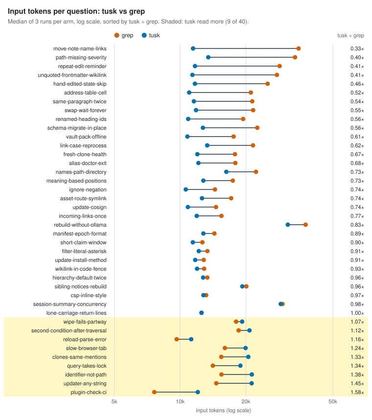
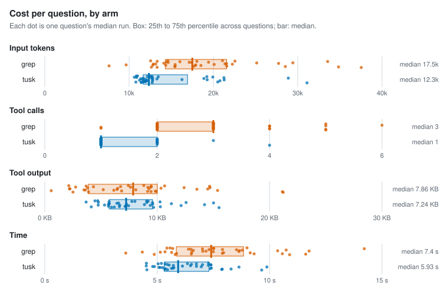
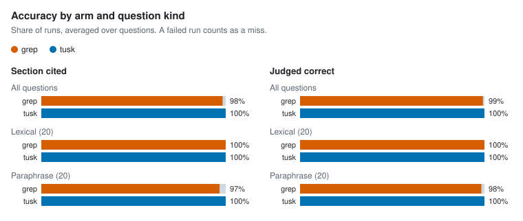

# Agent retrieval benchmark

- Corpus: 35 markdown files, 154 sections (docs/packages)
- Questions: 40, 3 repetitions per arm
- Agent model: claude-sonnet-5-5; judge: haiku
- tusk v1.0.0-dev (643557c, modified); Claude Code 2.1.301; 4 concurrent runs; 2026-10-15

## Per arm

Each figure is the median over questions of that question's median run, with the 25th to 75th percentile in brackets.

| Arm | Input tokens | Tool calls | Tool output | Time | Cost | Section cited | Judged correct | Runs (failed) |
| --- | --- | --- | --- | --- | --- | --- | --- | --- |
| grep | 17,494 [14,290–21,567] | 3 [2–3] | 7.9 KB [3.9 KB–10.0 KB] | 7.4 s [5.9 s–8.8 s] | $0.026 [$0.017–$0.033] | 98% | 99% | 120 (0) |
| tusk | 12,348 [11,655–16,926] | 1 [1–2] | 7.2 KB [5.7 KB–9.6 KB] | 5.9 s [5.3 s–7.3 s] | $0.024 [$0.023–$0.028] | 100% | 100% | 120 (0) |

## tusk vs grep, paired by question

A ratio below 1 means tusk used less than grep on the same question.

| Metric | Median ratio (tusk / grep) | 95% CI | Questions where tusk used less |
| --- | --- | --- | --- |
| Input tokens | 0.80 | 0.70–0.94 | 31 of 40 |
| Tool output | 0.94 | 0.73–1.59 | 20 of 40 |
| Time | 0.85 | 0.80–0.93 | 32 of 40 |
| Cost | 1.05 | 0.90–1.29 | 19 of 40 |

| Metric | Median difference (tusk − grep) | 95% CI | Questions where tusk used fewer |
| --- | --- | --- | --- |
| Tool calls | -1 | -2 to -1 | 33 of 40 |

| Accuracy | grep | tusk | Difference | 95% CI |
| --- | --- | --- | --- | --- |
| Section cited | 98% | 100% | +2 pp | +0 pp to +4 pp |
| Judged correct | 99% | 100% | +1 pp | +0 pp to +2 pp |

### By question kind

| Kind | Questions | Arm | Input tokens | Tool calls | Section cited | Judged correct |
| --- | --- | --- | --- | --- | --- | --- |
| lexical | 20 | grep | 15,029 | 2 | 100% | 100% |
| lexical | 20 | tusk | 12,362 | 1 | 100% | 100% |
| paraphrase | 20 | grep | 18,281 | 3 | 97% | 98% |
| paraphrase | 20 | tusk | 12,348 | 1 | 100% | 100% |

### Where tusk lost

9 of 40 questions: tusk read more input tokens than grep, or was judged correct less often.

| Question | Kind | Input tokens (grep → tusk) | Tool calls (grep → tusk) | Judged correct (grep / tusk) |
| --- | --- | --- | --- | --- |
| `clones-same-mentions` Two people clone the same vault on different machines with different files checked out. Will indexing record the same file mentions for both? | paraphrase | 15,431 → 20,520 | 3 → 2 | 100% / 100% |
| `identifier-not-path` Is an inline code span like `ExtractWikilinks` recorded as a path ref? | lexical | 15,462 → 21,283 | 2 → 2 | 100% / 100% |
| `plugin-check-ci` Why doesn't `make claude-plugin-check` run in CI? | lexical | 7,622 → 12,051 | 1 → 1 | 100% / 100% |
| `query-takes-lock` Does `tusk query` take the workspace lock? | lexical | 14,121 → 18,877 | 2 → 2 | 100% / 100% |
| `reload-parse-error` What happens if `tusk_reload` hits a TOML parse error in tusk.toml? | lexical | 9,648 → 11,239 | 1 → 1 | 100% / 100% |
| `second-condition-after-traversal` In a filter that follows links out to other notes and then adds a second condition after it, does the second condition apply to the linked notes or to the starting notes? | paraphrase | 18,523 → 20,776 | 3 → 2 | 100% / 100% |
| `slow-browser-tab` What happens to live updates for a browser tab that reads too slowly and falls behind? | paraphrase | 16,029 → 19,928 | 3 → 2 | 100% / 100% |
| `updater-any-string` What could go wrong if the self-updater accepted any string as the release to install? | paraphrase | 14,638 → 21,251 | 2 → 2 | 100% / 100% |
| `wipe-fails-partway` If wiping and recreating the search database fails partway through, will other running servers switch over to the half-finished copy? | paraphrase | 18,039 → 19,221 | 2 → 2 | 100% / 100% |

## Per question

| Question | Kind | Arm | Input tokens | Tool calls | Tool output | Time | Section cited | Judged correct | Failed |
| --- | --- | --- | --- | --- | --- | --- | --- | --- | --- |
| `address-table-cell` | lexical | grep | 21,077 | 3 | 8.8 KB | 9.0 s | 100% | 100% | 0 |
| `address-table-cell` | lexical | tusk | 11,001 | 1 | 4.7 KB | 7.3 s | 100% | 100% | 0 |
| `alias-doctor-exit` | lexical | grep | 17,899 | 2 | 8.1 KB | 5.1 s | 100% | 100% | 0 |
| `alias-doctor-exit` | lexical | tusk | 12,129 | 1 | 4.8 KB | 5.1 s | 100% | 100% | 0 |
| `asset-route-symlink` | lexical | grep | 17,124 | 3 | 2.7 KB | 7.9 s | 100% | 100% | 0 |
| `asset-route-symlink` | lexical | tusk | 12,595 | 1 | 9.1 KB | 7.4 s | 100% | 100% | 0 |
| `clones-same-mentions` | paraphrase | grep | 15,431 | 3 | 9.9 KB | 9.3 s | 100% | 100% | 0 |
| `clones-same-mentions` | paraphrase | tusk | 20,520 | 2 | 10.3 KB | 7.9 s | 100% | 100% | 0 |
| `csp-inline-style` | lexical | grep | 13,162 | 3 | 2.2 KB | 7.2 s | 100% | 100% | 0 |
| `csp-inline-style` | lexical | tusk | 12,787 | 1 | 9.6 KB | 4.8 s | 100% | 100% | 0 |
| `filter-literal-asterisk` | paraphrase | grep | 13,333 | 3 | 3.7 KB | 5.7 s | 100% | 100% | 0 |
| `filter-literal-asterisk` | paraphrase | tusk | 12,170 | 1 | 8.0 KB | 5.0 s | 100% | 100% | 0 |
| `fresh-clone-health` | paraphrase | grep | 17,818 | 3 | 15.4 KB | 9.1 s | 100% | 100% | 0 |
| `fresh-clone-health` | paraphrase | tusk | 11,991 | 1 | 7.5 KB | 5.7 s | 100% | 100% | 0 |
| `hand-edited-state-skip` | paraphrase | grep | 25,138 | 3 | 14.7 KB | 8.8 s | 100% | 100% | 0 |
| `hand-edited-state-skip` | paraphrase | tusk | 11,686 | 1 | 6.6 KB | 5.7 s | 100% | 100% | 0 |
| `hierarchy-default-twice` | lexical | grep | 13,325 | 2 | 2.5 KB | 5.8 s | 100% | 100% | 0 |
| `hierarchy-default-twice` | lexical | tusk | 12,744 | 1 | 9.7 KB | 4.5 s | 100% | 100% | 0 |
| `identifier-not-path` | lexical | grep | 15,462 | 2 | 6.4 KB | 5.3 s | 100% | 100% | 0 |
| `identifier-not-path` | lexical | tusk | 21,283 | 2 | 14.2 KB | 8.6 s | 100% | 100% | 0 |
| `ignore-negation` | lexical | grep | 14,442 | 2 | 4.3 KB | 6.4 s | 100% | 100% | 0 |
| `ignore-negation` | lexical | tusk | 10,619 | 1 | 3.7 KB | 5.4 s | 100% | 100% | 0 |
| `incoming-links-once` | paraphrase | grep | 15,457 | 2 | 9.8 KB | 5.9 s | 100% | 100% | 0 |
| `incoming-links-once` | paraphrase | tusk | 11,910 | 1 | 7.1 KB | 5.4 s | 100% | 100% | 0 |
| `link-case-reprocess` | lexical | grep | 21,560 | 4 | 6.5 KB | 10.4 s | 100% | 100% | 0 |
| `link-case-reprocess` | lexical | tusk | 13,308 | 1 | 11.3 KB | 6.1 s | 100% | 100% | 0 |
| `lone-carriage-return-lines` | paraphrase | grep | 12,549 | 2 | 2.1 KB | 5.4 s | 100% | 100% | 0 |
| `lone-carriage-return-lines` | paraphrase | tusk | 12,525 | 1 | 9.1 KB | 5.2 s | 100% | 100% | 0 |
| `manifest-epoch-format` | lexical | grep | 14,347 | 2 | 3.6 KB | 5.6 s | 100% | 100% | 0 |
| `manifest-epoch-format` | lexical | tusk | 12,775 | 1 | 9.4 KB | 5.7 s | 100% | 100% | 0 |
| `meaning-based-positions` | paraphrase | grep | 17,418 | 2 | 9.2 KB | 8.5 s | 100% | 100% | 0 |
| `meaning-based-positions` | paraphrase | tusk | 12,780 | 1 | 9.6 KB | 5.5 s | 100% | 100% | 0 |
| `move-note-name-links` | paraphrase | grep | 34,847 | 5 | 21.1 KB | 11.6 s | 100% | 100% | 0 |
| `move-note-name-links` | paraphrase | tusk | 11,462 | 1 | 6.2 KB | 7.9 s | 100% | 100% | 0 |
| `names-path-directory` | lexical | grep | 22,252 | 2 | 14.5 KB | 8.6 s | 100% | 100% | 0 |
| `names-path-directory` | lexical | tusk | 16,275 | 2 | 5.7 KB | 7.0 s | 100% | 100% | 0 |
| `path-missing-severity` | lexical | grep | 33,553 | 5 | 14.7 KB | 14.2 s | 100% | 100% | 0 |
| `path-missing-severity` | lexical | tusk | 13,452 | 1 | 5.7 KB | 5.4 s | 100% | 100% | 0 |
| `plugin-check-ci` | lexical | grep | 7,622 | 1 | 0.6 KB | 3.6 s | 100% | 100% | 0 |
| `plugin-check-ci` | lexical | tusk | 12,051 | 1 | 7.2 KB | 5.6 s | 100% | 100% | 0 |
| `query-takes-lock` | lexical | grep | 14,121 | 2 | 3.8 KB | 6.6 s | 100% | 100% | 0 |
| `query-takes-lock` | lexical | tusk | 18,877 | 2 | 6.4 KB | 6.5 s | 100% | 100% | 0 |
| `rebuild-without-ollama` | paraphrase | grep | 37,537 | 5 | 21.2 KB | 10.9 s | 67% | 100% | 0 |
| `rebuild-without-ollama` | paraphrase | tusk | 31,105 | 4 | 15.5 KB | 9.6 s | 100% | 100% | 0 |
| `reload-parse-error` | lexical | grep | 9,648 | 1 | 5.2 KB | 4.3 s | 100% | 100% | 0 |
| `reload-parse-error` | lexical | tusk | 11,239 | 1 | 5.3 KB | 5.1 s | 100% | 100% | 0 |
| `renamed-heading-ids` | paraphrase | grep | 19,427 | 2 | 9.5 KB | 6.5 s | 100% | 100% | 0 |
| `renamed-heading-ids` | paraphrase | tusk | 10,889 | 1 | 4.8 KB | 7.0 s | 100% | 100% | 0 |
| `repeat-edit-reminder` | paraphrase | grep | 28,539 | 4 | 9.2 KB | 10.6 s | 100% | 100% | 0 |
| `repeat-edit-reminder` | paraphrase | tusk | 11,697 | 1 | 6.6 KB | 8.3 s | 100% | 100% | 0 |
| `same-paragraph-twice` | paraphrase | grep | 21,378 | 4 | 9.3 KB | 11.8 s | 100% | 100% | 0 |
| `same-paragraph-twice` | paraphrase | tusk | 11,563 | 1 | 5.7 KB | 6.7 s | 100% | 100% | 0 |
| `schema-migrate-in-place` | lexical | grep | 22,561 | 3 | 10.7 KB | 7.5 s | 100% | 100% | 0 |
| `schema-migrate-in-place` | lexical | tusk | 12,718 | 1 | 9.2 KB | 6.3 s | 100% | 100% | 0 |
| `second-condition-after-traversal` | paraphrase | grep | 18,523 | 3 | 6.1 KB | 8.0 s | 100% | 100% | 0 |
| `second-condition-after-traversal` | paraphrase | tusk | 20,776 | 2 | 12.1 KB | 7.4 s | 100% | 100% | 0 |
| `session-summary-concurrency` | paraphrase | grep | 29,424 | 6 | 12.4 KB | 10.7 s | 100% | 100% | 0 |
| `session-summary-concurrency` | paraphrase | tusk | 28,888 | 3 | 15.0 KB | 7.3 s | 100% | 100% | 0 |
| `short-claim-window` | paraphrase | grep | 12,649 | 2 | 3.9 KB | 4.9 s | 100% | 100% | 0 |
| `short-claim-window` | paraphrase | tusk | 11,439 | 1 | 5.9 KB | 5.5 s | 100% | 100% | 0 |
| `sibling-notices-rebuild` | paraphrase | grep | 20,094 | 3 | 13.5 KB | 7.5 s | 67% | 67% | 0 |
| `sibling-notices-rebuild` | paraphrase | tusk | 19,263 | 2 | 8.9 KB | 9.9 s | 100% | 100% | 0 |
| `slow-browser-tab` | paraphrase | grep | 16,029 | 3 | 6.7 KB | 7.0 s | 100% | 100% | 0 |
| `slow-browser-tab` | paraphrase | tusk | 19,928 | 2 | 10.3 KB | 6.5 s | 100% | 100% | 0 |
| `swap-wait-forever` | paraphrase | grep | 21,589 | 4 | 6.8 KB | 7.9 s | 100% | 100% | 0 |
| `swap-wait-forever` | paraphrase | tusk | 11,826 | 1 | 5.7 KB | 7.4 s | 100% | 100% | 0 |
| `unquoted-frontmatter-wikilink` | lexical | grep | 27,735 | 5 | 10.3 KB | 8.7 s | 100% | 100% | 0 |
| `unquoted-frontmatter-wikilink` | lexical | tusk | 11,384 | 1 | 5.7 KB | 4.5 s | 100% | 100% | 0 |
| `update-cosign` | lexical | grep | 14,596 | 3 | 7.4 KB | 5.6 s | 100% | 100% | 0 |
| `update-cosign` | lexical | tusk | 10,853 | 1 | 4.5 KB | 4.5 s | 100% | 100% | 0 |
| `update-install-method` | lexical | grep | 12,823 | 2 | 3.5 KB | 6.5 s | 100% | 100% | 0 |
| `update-install-method` | lexical | tusk | 11,721 | 1 | 6.7 KB | 5.2 s | 100% | 100% | 0 |
| `updater-any-string` | paraphrase | grep | 14,638 | 2 | 7.6 KB | 7.3 s | 100% | 100% | 0 |
| `updater-any-string` | paraphrase | tusk | 21,251 | 2 | 12.6 KB | 7.4 s | 100% | 100% | 0 |
| `vault-pack-offline` | lexical | grep | 17,571 | 3 | 9.5 KB | 6.5 s | 100% | 100% | 0 |
| `vault-pack-offline` | lexical | tusk | 10,801 | 1 | 4.1 KB | 5.3 s | 100% | 100% | 0 |
| `wikilink-in-code-fence` | lexical | grep | 12,875 | 2 | 2.2 KB | 7.0 s | 100% | 100% | 0 |
| `wikilink-in-code-fence` | lexical | tusk | 11,955 | 1 | 7.3 KB | 4.9 s | 100% | 100% | 0 |
| `wipe-fails-partway` | paraphrase | grep | 18,039 | 2 | 9.5 KB | 7.5 s | 100% | 100% | 0 |
| `wipe-fails-partway` | paraphrase | tusk | 19,221 | 2 | 7.7 KB | 6.7 s | 100% | 100% | 0 |

## Charts

<picture>
  <source media="(prefers-color-scheme: dark)" srcset="charts/tokens-tusk-vs-grep-dark.svg">
  
</picture>

<picture>
  <source media="(prefers-color-scheme: dark)" srcset="charts/per-arm-dark.svg">
  
</picture>

<picture>
  <source media="(prefers-color-scheme: dark)" srcset="charts/accuracy-dark.svg">
  
</picture>

