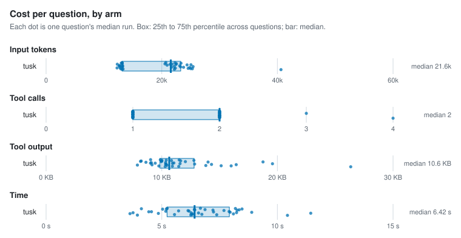
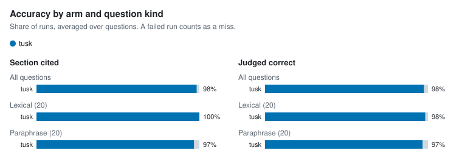

# Agent retrieval benchmark

- Corpus: 35 markdown files, 154 sections (docs/packages)
- Questions: 40, 3 repetitions per arm
- Agent model: claude-sonnet-5-5; judge: haiku
- tusk v1.0.0-dev (fa5e37f); Claude Code 2.1.300; 4 concurrent runs; 2026-10-15

## Per arm

Each figure is the median over questions of that question's median run, with the 25th to 75th percentile in brackets.

| Arm | Input tokens | Tool calls | Tool output | Time | Cost | Section cited | Judged correct | Runs (failed) |
| --- | --- | --- | --- | --- | --- | --- | --- | --- |
| tusk | 21,566 [13,141–23,279] | 2 [1–2] | 10.6 KB [9.8 KB–12.8 KB] | 6.4 s [5.2 s–7.9 s] | $0.033 [$0.028–$0.037] | 98% | 98% | 120 (0) |

## Per question

| Question | Kind | Arm | Input tokens | Tool calls | Tool output | Time | Section cited | Judged correct | Failed |
| --- | --- | --- | --- | --- | --- | --- | --- | --- | --- |
| `address-table-cell` | lexical | tusk | 20,710 | 2 | 9.0 KB | 6.7 s | 100% | 100% | 0 |
| `alias-doctor-exit` | lexical | tusk | 13,183 | 1 | 10.3 KB | 3.8 s | 100% | 100% | 0 |
| `asset-route-symlink` | lexical | tusk | 12,318 | 1 | 8.2 KB | 6.4 s | 100% | 100% | 0 |
| `clones-same-mentions` | paraphrase | tusk | 25,294 | 2 | 16.0 KB | 6.3 s | 100% | 100% | 0 |
| `csp-inline-style` | lexical | tusk | 12,667 | 1 | 9.0 KB | 4.6 s | 100% | 100% | 0 |
| `filter-literal-asterisk` | paraphrase | tusk | 12,993 | 1 | 10.0 KB | 5.2 s | 100% | 100% | 0 |
| `fresh-clone-health` | paraphrase | tusk | 12,800 | 1 | 9.2 KB | 4.9 s | 100% | 100% | 0 |
| `hand-edited-state-skip` | paraphrase | tusk | 24,382 | 2 | 14.0 KB | 6.1 s | 100% | 100% | 0 |
| `hierarchy-default-twice` | lexical | tusk | 13,142 | 1 | 10.3 KB | 3.9 s | 100% | 100% | 0 |
| `identifier-not-path` | lexical | tusk | 25,412 | 2 | 19.6 KB | 8.9 s | 100% | 100% | 0 |
| `ignore-negation` | lexical | tusk | 20,556 | 1 | 8.2 KB | 6.9 s | 100% | 100% | 0 |
| `incoming-links-once` | paraphrase | tusk | 24,564 | 2 | 13.8 KB | 6.3 s | 100% | 100% | 0 |
| `link-case-reprocess` | lexical | tusk | 12,674 | 1 | 9.1 KB | 5.2 s | 100% | 100% | 0 |
| `lone-carriage-return-lines` | paraphrase | tusk | 22,289 | 2 | 11.5 KB | 8.2 s | 100% | 100% | 0 |
| `manifest-epoch-format` | lexical | tusk | 23,774 | 2 | 14.3 KB | 6.6 s | 100% | 100% | 0 |
| `meaning-based-positions` | paraphrase | tusk | 22,449 | 2 | 12.0 KB | 8.3 s | 100% | 100% | 0 |
| `move-note-name-links` | paraphrase | tusk | 13,314 | 1 | 10.9 KB | 7.4 s | 100% | 100% | 0 |
| `names-path-directory` | lexical | tusk | 13,237 | 2 | 10.9 KB | 7.2 s | 100% | 100% | 0 |
| `path-missing-severity` | lexical | tusk | 13,139 | 1 | 10.8 KB | 5.0 s | 100% | 100% | 0 |
| `plugin-check-ci` | lexical | tusk | 12,269 | 1 | 7.9 KB | 3.6 s | 100% | 100% | 0 |
| `query-takes-lock` | lexical | tusk | 20,931 | 2 | 8.6 KB | 5.7 s | 100% | 67% | 0 |
| `rebuild-without-ollama` | paraphrase | tusk | 40,613 | 4 | 26.3 KB | 10.4 s | 100% | 100% | 0 |
| `reload-parse-error` | lexical | tusk | 23,263 | 2 | 12.8 KB | 8.2 s | 100% | 100% | 0 |
| `renamed-heading-ids` | paraphrase | tusk | 21,801 | 1 | 10.0 KB | 8.3 s | 100% | 100% | 0 |
| `repeat-edit-reminder` | paraphrase | tusk | 24,992 | 2 | 15.1 KB | 6.7 s | 100% | 100% | 0 |
| `same-paragraph-twice` | paraphrase | tusk | 23,107 | 1 | 11.0 KB | 7.9 s | 100% | 100% | 0 |
| `schema-migrate-in-place` | lexical | tusk | 13,174 | 1 | 10.4 KB | 4.1 s | 100% | 100% | 0 |
| `second-condition-after-traversal` | paraphrase | tusk | 24,839 | 2 | 16.4 KB | 11.4 s | 100% | 100% | 0 |
| `session-summary-concurrency` | paraphrase | tusk | 25,054 | 3 | 18.8 KB | 7.7 s | 100% | 100% | 0 |
| `short-claim-window` | paraphrase | tusk | 22,180 | 2 | 11.5 KB | 6.3 s | 100% | 100% | 0 |
| `sibling-notices-rebuild` | paraphrase | tusk | 22,167 | 2 | 11.6 KB | 8.0 s | 33% | 33% | 0 |
| `slow-browser-tab` | paraphrase | tusk | 22,546 | 2 | 11.6 KB | 6.4 s | 100% | 100% | 0 |
| `swap-wait-forever` | paraphrase | tusk | 22,349 | 1 | 10.5 KB | 8.1 s | 100% | 100% | 0 |
| `unquoted-frontmatter-wikilink` | lexical | tusk | 13,204 | 1 | 10.3 KB | 6.2 s | 100% | 100% | 0 |
| `update-cosign` | lexical | tusk | 13,127 | 1 | 9.9 KB | 5.2 s | 100% | 100% | 0 |
| `update-install-method` | lexical | tusk | 21,678 | 2 | 10.4 KB | 6.3 s | 100% | 100% | 0 |
| `updater-any-string` | paraphrase | tusk | 21,454 | 2 | 9.9 KB | 7.2 s | 100% | 100% | 0 |
| `vault-pack-offline` | lexical | tusk | 12,917 | 1 | 9.8 KB | 5.6 s | 100% | 100% | 0 |
| `wikilink-in-code-fence` | lexical | tusk | 12,800 | 1 | 9.4 KB | 4.4 s | 100% | 100% | 0 |
| `wipe-fails-partway` | paraphrase | tusk | 23,326 | 2 | 12.8 KB | 8.5 s | 100% | 100% | 0 |

## Charts

<picture>
  <source media="(prefers-color-scheme: dark)" srcset="charts/per-arm-dark.svg">
  
</picture>

<picture>
  <source media="(prefers-color-scheme: dark)" srcset="charts/accuracy-dark.svg">
  
</picture>

