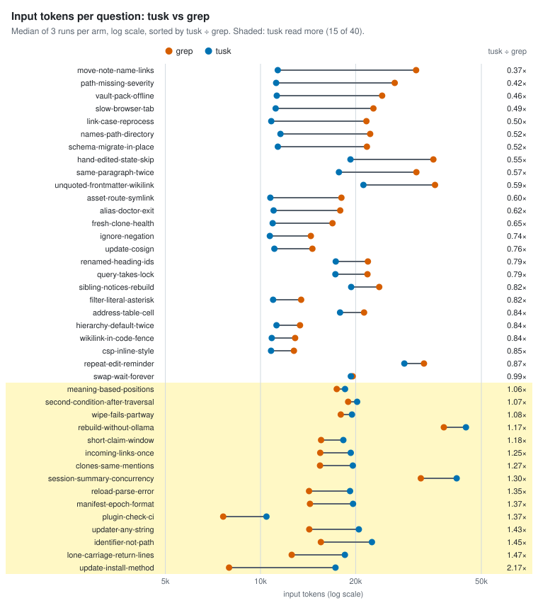
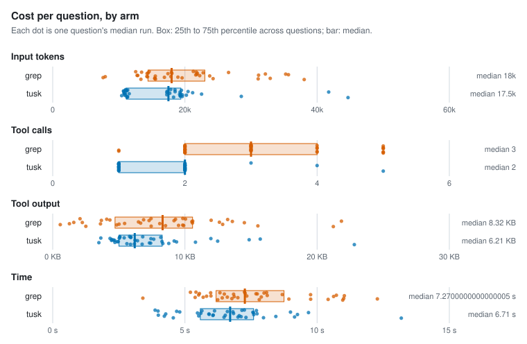
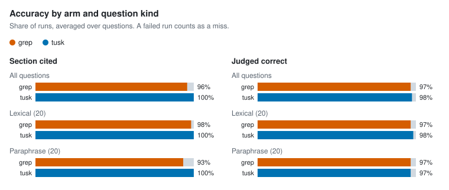

# Agent retrieval benchmark

- Corpus: 35 markdown files, 154 sections (docs/packages)
- Questions: 40, 3 repetitions per arm
- Agent model: claude-sonnet-5-5; judge: haiku
- tusk v1.0.0-dev (4a86376); Claude Code 2.1.300; 4 concurrent runs; 2026-10-15

## Per arm

Each figure is the median over questions of that question's median run, with the 25th to 75th percentile in brackets.

| Arm | Input tokens | Tool calls | Tool output | Time | Cost | Section cited | Judged correct | Runs (failed) |
| --- | --- | --- | --- | --- | --- | --- | --- | --- |
| grep | 17,992 [14,412–23,012] | 3 [2–4] | 8.3 KB [4.7 KB–10.6 KB] | 7.3 s [6.2 s–8.7 s] | $0.026 [$0.019–$0.033] | 96% | 97% | 120 (0) |
| tusk | 17,506 [11,142–19,389] | 2 [1–2] | 6.2 KB [5.0 KB–8.3 KB] | 6.7 s [5.6 s–7.6 s] | $0.024 [$0.020–$0.028] | 100% | 98% | 120 (0) |

## tusk vs grep, paired by question

A ratio below 1 means tusk used less than grep on the same question.

| Metric | Median ratio (tusk / grep) | 95% CI | Questions where tusk used less |
| --- | --- | --- | --- |
| Input tokens | 0.84 | 0.76–1.06 | 25 of 40 |
| Tool output | 0.87 | 0.73–1.33 | 23 of 40 |
| Time | 0.88 | 0.77–1.01 | 25 of 40 |
| Cost | 1.03 | 0.90–1.20 | 18 of 40 |

| Metric | Median difference (tusk − grep) | 95% CI | Questions where tusk used fewer |
| --- | --- | --- | --- |
| Tool calls | -1 | -2 to -1 | 27 of 40 |

| Accuracy | grep | tusk | Difference | 95% CI |
| --- | --- | --- | --- | --- |
| Section cited | 96% | 100% | +4 pp | +1 pp to +8 pp |
| Judged correct | 97% | 98% | +1 pp | -3 pp to +6 pp |

### By question kind

| Kind | Questions | Arm | Input tokens | Tool calls | Section cited | Judged correct |
| --- | --- | --- | --- | --- | --- | --- |
| lexical | 20 | grep | 16,700 | 3 | 98% | 97% |
| lexical | 20 | tusk | 11,250 | 1 | 100% | 98% |
| paraphrase | 20 | grep | 19,260 | 3 | 93% | 97% |
| paraphrase | 20 | tusk | 19,285 | 2 | 100% | 97% |

### Where tusk lost

17 of 40 questions: tusk read more input tokens than grep, or was judged correct less often.

| Question | Kind | Input tokens (grep → tusk) | Tool calls (grep → tusk) | Judged correct (grep / tusk) |
| --- | --- | --- | --- | --- |
| `clones-same-mentions` Two people clone the same vault on different machines with different files checked out. Will indexing record the same file mentions for both? | paraphrase | 15,431 → 19,591 | 2 → 2 | 100% / 100% |
| `hand-edited-state-skip` Someone edits a work item's markdown by hand so its state jumps forward and skips a required intermediate step. Will re-indexing catch that? | paraphrase | 35,249 → 19,266 | 4 → 2 | 100% / 67% |
| `identifier-not-path` Is an inline code span like `ExtractWikilinks` recorded as a path ref? | lexical | 15,525 → 22,522 | 2 → 2 | 100% / 100% |
| `incoming-links-once` When several parts of a single page all reference the same note, does the reader's incoming-links list show that page once or once per part? | paraphrase | 15,457 → 19,304 | 2 → 2 | 100% / 100% |
| `lone-carriage-return-lines` A file uses bare carriage returns as line breaks, like old Mac files. With default settings, will tusk's reported line numbers match what most editors show? | paraphrase | 12,553 → 18,493 | 2 → 2 | 100% / 100% |
| `manifest-epoch-format` What is the on-disk format of `.tusk/manifest-epoch`, and can it be changed? | lexical | 14,345 → 19,622 | 2 → 2 | 100% / 100% |
| `meaning-based-positions` When the 3D view arranges notes by meaning instead of by links, how are their positions computed? | paraphrase | 17,433 → 18,515 | 2 → 2 | 100% / 100% |
| `plugin-check-ci` Why doesn't `make claude-plugin-check` run in CI? | lexical | 7,622 → 10,442 | 1 → 1 | 100% / 100% |
| `query-takes-lock` Does `tusk query` take the workspace lock? | lexical | 21,802 → 17,263 | 3 → 2 | 100% / 67% |
| `rebuild-without-ollama` What happens when you rebuild the index while Ollama isn't running? | paraphrase | 38,047 → 44,675 | 5 → 5 | 100% / 100% |
| `reload-parse-error` What happens if `tusk_reload` hits a TOML parse error in tusk.toml? | lexical | 14,246 → 19,205 | 3 → 2 | 100% / 100% |
| `second-condition-after-traversal` In a filter that follows links out to other notes and then adds a second condition after it, does the second condition apply to the linked notes or to the starting notes? | paraphrase | 18,942 → 20,225 | 3 → 2 | 100% / 100% |
| `session-summary-concurrency` When a Claude Code session starts, the vault summary can include several named saved queries. Are those run one after another or concurrently? | paraphrase | 32,172 → 41,752 | 5 → 4 | 100% / 100% |
| `short-claim-window` What goes wrong if the time a worker may hold a claimed job is set very short, like one second? | paraphrase | 15,550 → 18,286 | 2 → 2 | 100% / 100% |
| `update-install-method` How does `tusk update` tell a `go install` binary apart from a local `make build`, given both report a -dev version? | lexical | 7,956 → 17,266 | 1 → 2 | 100% / 100% |
| `updater-any-string` What could go wrong if the self-updater accepted any string as the release to install? | paraphrase | 14,271 → 20,475 | 2 → 2 | 100% / 100% |
| `wipe-fails-partway` If wiping and recreating the search database fails partway through, will other running servers switch over to the half-finished copy? | paraphrase | 17,953 → 19,477 | 2 → 2 | 100% / 67% |

## Per question

| Question | Kind | Arm | Input tokens | Tool calls | Tool output | Time | Section cited | Judged correct | Failed |
| --- | --- | --- | --- | --- | --- | --- | --- | --- | --- |
| `address-table-cell` | lexical | grep | 21,276 | 3 | 9.8 KB | 7.3 s | 100% | 100% | 0 |
| `address-table-cell` | lexical | tusk | 17,854 | 3 | 5.8 KB | 7.2 s | 100% | 100% | 0 |
| `alias-doctor-exit` | lexical | grep | 17,874 | 2 | 8.1 KB | 6.6 s | 100% | 100% | 0 |
| `alias-doctor-exit` | lexical | tusk | 11,005 | 1 | 5.0 KB | 4.0 s | 100% | 100% | 0 |
| `asset-route-symlink` | lexical | grep | 18,031 | 3 | 3.7 KB | 7.7 s | 100% | 100% | 0 |
| `asset-route-symlink` | lexical | tusk | 10,747 | 1 | 4.3 KB | 4.8 s | 100% | 100% | 0 |
| `clones-same-mentions` | paraphrase | grep | 15,431 | 2 | 9.9 KB | 8.9 s | 100% | 100% | 0 |
| `clones-same-mentions` | paraphrase | tusk | 19,591 | 2 | 8.3 KB | 7.0 s | 100% | 100% | 0 |
| `csp-inline-style` | lexical | grep | 12,761 | 3 | 1.6 KB | 6.0 s | 100% | 67% | 0 |
| `csp-inline-style` | lexical | tusk | 10,799 | 1 | 4.5 KB | 4.3 s | 100% | 100% | 0 |
| `filter-literal-asterisk` | paraphrase | grep | 13,449 | 3 | 4.1 KB | 6.3 s | 100% | 100% | 0 |
| `filter-literal-asterisk` | paraphrase | tusk | 10,963 | 1 | 5.1 KB | 5.6 s | 100% | 100% | 0 |
| `fresh-clone-health` | paraphrase | grep | 16,902 | 3 | 12.9 KB | 6.4 s | 100% | 100% | 0 |
| `fresh-clone-health` | paraphrase | tusk | 10,931 | 1 | 4.7 KB | 5.5 s | 100% | 100% | 0 |
| `hand-edited-state-skip` | paraphrase | grep | 35,249 | 4 | 21.8 KB | 9.8 s | 100% | 100% | 0 |
| `hand-edited-state-skip` | paraphrase | tusk | 19,266 | 2 | 7.6 KB | 7.6 s | 100% | 67% | 0 |
| `hierarchy-default-twice` | lexical | grep | 13,338 | 2 | 2.5 KB | 6.2 s | 100% | 100% | 0 |
| `hierarchy-default-twice` | lexical | tusk | 11,238 | 1 | 5.9 KB | 4.6 s | 100% | 100% | 0 |
| `identifier-not-path` | lexical | grep | 15,525 | 2 | 6.7 KB | 6.9 s | 100% | 100% | 0 |
| `identifier-not-path` | lexical | tusk | 22,522 | 2 | 12.5 KB | 7.6 s | 100% | 100% | 0 |
| `ignore-negation` | lexical | grep | 14,435 | 2 | 4.3 KB | 5.5 s | 100% | 100% | 0 |
| `ignore-negation` | lexical | tusk | 10,703 | 1 | 3.6 KB | 6.6 s | 100% | 100% | 0 |
| `incoming-links-once` | paraphrase | grep | 15,457 | 2 | 9.8 KB | 6.8 s | 100% | 100% | 0 |
| `incoming-links-once` | paraphrase | tusk | 19,304 | 2 | 7.4 KB | 7.1 s | 100% | 100% | 0 |
| `link-case-reprocess` | lexical | grep | 21,635 | 4 | 6.5 KB | 8.1 s | 100% | 100% | 0 |
| `link-case-reprocess` | lexical | tusk | 10,817 | 1 | 4.6 KB | 6.8 s | 100% | 100% | 0 |
| `lone-carriage-return-lines` | paraphrase | grep | 12,553 | 2 | 2.1 KB | 5.2 s | 100% | 100% | 0 |
| `lone-carriage-return-lines` | paraphrase | tusk | 18,493 | 2 | 6.8 KB | 7.2 s | 100% | 100% | 0 |
| `manifest-epoch-format` | lexical | grep | 14,345 | 2 | 3.6 KB | 5.4 s | 100% | 100% | 0 |
| `manifest-epoch-format` | lexical | tusk | 19,622 | 2 | 9.4 KB | 6.1 s | 100% | 100% | 0 |
| `meaning-based-positions` | paraphrase | grep | 17,433 | 2 | 9.2 KB | 6.8 s | 100% | 100% | 0 |
| `meaning-based-positions` | paraphrase | tusk | 18,515 | 2 | 7.4 KB | 7.6 s | 100% | 100% | 0 |
| `move-note-name-links` | paraphrase | grep | 31,076 | 5 | 15.5 KB | 10.4 s | 100% | 100% | 0 |
| `move-note-name-links` | paraphrase | tusk | 11,343 | 1 | 6.2 KB | 7.3 s | 100% | 100% | 0 |
| `names-path-directory` | lexical | grep | 22,239 | 2 | 14.5 KB | 5.8 s | 100% | 100% | 0 |
| `names-path-directory` | lexical | tusk | 11,567 | 1 | 6.4 KB | 5.9 s | 100% | 100% | 0 |
| `path-missing-severity` | lexical | grep | 26,599 | 5 | 13.2 KB | 8.0 s | 100% | 67% | 0 |
| `path-missing-severity` | lexical | tusk | 11,207 | 1 | 5.9 KB | 4.0 s | 100% | 100% | 0 |
| `plugin-check-ci` | lexical | grep | 7,622 | 1 | 0.6 KB | 3.4 s | 100% | 100% | 0 |
| `plugin-check-ci` | lexical | tusk | 10,442 | 1 | 3.5 KB | 4.2 s | 100% | 100% | 0 |
| `query-takes-lock` | lexical | grep | 21,802 | 3 | 13.6 KB | 5.5 s | 67% | 100% | 0 |
| `query-takes-lock` | lexical | tusk | 17,263 | 2 | 4.5 KB | 5.5 s | 100% | 67% | 0 |
| `rebuild-without-ollama` | paraphrase | grep | 38,047 | 5 | 21.2 KB | 11.0 s | 67% | 100% | 0 |
| `rebuild-without-ollama` | paraphrase | tusk | 44,675 | 5 | 22.8 KB | 13.2 s | 100% | 100% | 0 |
| `reload-parse-error` | lexical | grep | 14,246 | 3 | 5.4 KB | 7.9 s | 100% | 100% | 0 |
| `reload-parse-error` | lexical | tusk | 19,205 | 2 | 8.3 KB | 6.1 s | 100% | 100% | 0 |
| `renamed-heading-ids` | paraphrase | grep | 21,876 | 3 | 12.0 KB | 7.7 s | 100% | 100% | 0 |
| `renamed-heading-ids` | paraphrase | tusk | 17,305 | 2 | 5.0 KB | 6.8 s | 100% | 100% | 0 |
| `repeat-edit-reminder` | paraphrase | grep | 32,908 | 5 | 9.5 KB | 12.3 s | 67% | 100% | 0 |
| `repeat-edit-reminder` | paraphrase | tusk | 28,529 | 2 | 8.8 KB | 9.1 s | 100% | 100% | 0 |
| `same-paragraph-twice` | paraphrase | grep | 31,139 | 5 | 12.6 KB | 11.0 s | 100% | 100% | 0 |
| `same-paragraph-twice` | paraphrase | tusk | 17,708 | 1 | 6.2 KB | 7.7 s | 100% | 100% | 0 |
| `schema-migrate-in-place` | lexical | grep | 21,711 | 4 | 10.0 KB | 8.1 s | 100% | 100% | 0 |
| `schema-migrate-in-place` | lexical | tusk | 11,348 | 1 | 5.9 KB | 7.7 s | 100% | 100% | 0 |
| `second-condition-after-traversal` | paraphrase | grep | 18,942 | 3 | 5.0 KB | 7.0 s | 100% | 100% | 0 |
| `second-condition-after-traversal` | paraphrase | tusk | 20,225 | 2 | 10.8 KB | 7.1 s | 100% | 100% | 0 |
| `session-summary-concurrency` | paraphrase | grep | 32,172 | 5 | 10.6 KB | 8.7 s | 67% | 100% | 0 |
| `session-summary-concurrency` | paraphrase | tusk | 41,752 | 4 | 15.7 KB | 9.7 s | 100% | 100% | 0 |
| `short-claim-window` | paraphrase | grep | 15,550 | 2 | 7.5 KB | 7.8 s | 100% | 100% | 0 |
| `short-claim-window` | paraphrase | tusk | 18,286 | 2 | 6.8 KB | 8.0 s | 100% | 100% | 0 |
| `sibling-notices-rebuild` | paraphrase | grep | 23,751 | 3 | 10.6 KB | 10.6 s | 67% | 33% | 0 |
| `sibling-notices-rebuild` | paraphrase | tusk | 19,360 | 2 | 9.2 KB | 9.3 s | 100% | 100% | 0 |
| `slow-browser-tab` | paraphrase | grep | 22,766 | 3 | 6.9 KB | 7.3 s | 100% | 100% | 0 |
| `slow-browser-tab` | paraphrase | tusk | 11,167 | 1 | 5.4 KB | 4.7 s | 100% | 100% | 0 |
| `swap-wait-forever` | paraphrase | grep | 19,577 | 4 | 4.8 KB | 11.0 s | 100% | 100% | 0 |
| `swap-wait-forever` | paraphrase | tusk | 19,318 | 2 | 7.3 KB | 8.4 s | 100% | 100% | 0 |
| `unquoted-frontmatter-wikilink` | lexical | grep | 35,663 | 5 | 10.5 KB | 10.7 s | 100% | 100% | 0 |
| `unquoted-frontmatter-wikilink` | lexical | tusk | 21,170 | 2 | 14.9 KB | 5.6 s | 100% | 100% | 0 |
| `update-cosign` | lexical | grep | 14,596 | 3 | 7.4 KB | 5.4 s | 100% | 100% | 0 |
| `update-cosign` | lexical | tusk | 11,066 | 1 | 5.1 KB | 3.9 s | 100% | 100% | 0 |
| `update-install-method` | lexical | grep | 7,956 | 1 | 1.3 KB | 5.7 s | 100% | 100% | 0 |
| `update-install-method` | lexical | tusk | 17,266 | 2 | 4.9 KB | 6.5 s | 100% | 100% | 0 |
| `updater-any-string` | paraphrase | grep | 14,271 | 2 | 7.3 KB | 6.5 s | 100% | 100% | 0 |
| `updater-any-string` | paraphrase | tusk | 20,475 | 2 | 12.0 KB | 9.0 s | 100% | 100% | 0 |
| `vault-pack-offline` | lexical | grep | 24,266 | 4 | 8.5 KB | 9.8 s | 100% | 100% | 0 |
| `vault-pack-offline` | lexical | tusk | 11,261 | 1 | 5.6 KB | 6.5 s | 100% | 100% | 0 |
| `wikilink-in-code-fence` | lexical | grep | 12,867 | 2 | 2.2 KB | 7.3 s | 100% | 100% | 0 |
| `wikilink-in-code-fence` | lexical | tusk | 10,857 | 1 | 4.7 KB | 5.9 s | 100% | 100% | 0 |
| `wipe-fails-partway` | paraphrase | grep | 17,953 | 2 | 9.3 KB | 6.0 s | 100% | 100% | 0 |
| `wipe-fails-partway` | paraphrase | tusk | 19,477 | 2 | 8.2 KB | 6.1 s | 100% | 67% | 0 |

## Charts

<picture>
  <source media="(prefers-color-scheme: dark)" srcset="charts/tokens-tusk-vs-grep-dark.svg">
  
</picture>

<picture>
  <source media="(prefers-color-scheme: dark)" srcset="charts/per-arm-dark.svg">
  
</picture>

<picture>
  <source media="(prefers-color-scheme: dark)" srcset="charts/accuracy-dark.svg">
  
</picture>

