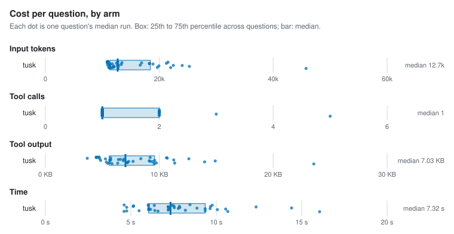
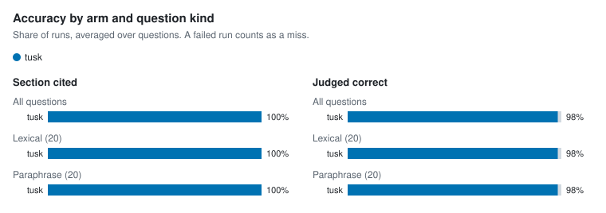

# Agent retrieval benchmark

- Corpus: 35 markdown files, 154 sections (docs/packages)
- Questions: 40, 3 repetitions per arm
- Agent model: claude-sonnet-5-5; judge: haiku
- tusk v1.0.0-dev; Claude Code 2.1.301; 4 concurrent runs; 2026-10-16

## Per arm

Each figure is the median over questions of that question's median run, with the 25th to 75th percentile in brackets.

| Arm | Input tokens | Tool calls | Tool output | Time | Cost | Section cited | Judged correct | Runs (failed) |
| --- | --- | --- | --- | --- | --- | --- | --- | --- |
| tusk | 12,690 [11,328–18,429] | 1 [1–2] | 7.0 KB [5.6 KB–9.6 KB] | 7.3 s [6.0 s–9.4 s] | $0.025 [$0.022–$0.030] | 100% | 98% | 120 (0) |

## Per question

| Question | Kind | Arm | Input tokens | Tool calls | Tool output | Time | Section cited | Judged correct | Failed |
| --- | --- | --- | --- | --- | --- | --- | --- | --- | --- |
| `address-table-cell` | lexical | tusk | 10,983 | 1 | 4.7 KB | 8.5 s | 100% | 100% | 0 |
| `alias-doctor-exit` | lexical | tusk | 19,929 | 1 | 7.7 KB | 7.2 s | 100% | 100% | 0 |
| `asset-route-symlink` | lexical | tusk | 12,484 | 1 | 8.4 KB | 5.1 s | 100% | 100% | 0 |
| `clones-same-mentions` | paraphrase | tusk | 21,992 | 2 | 11.4 KB | 9.4 s | 100% | 100% | 0 |
| `csp-inline-style` | lexical | tusk | 12,783 | 1 | 9.6 KB | 8.9 s | 100% | 100% | 0 |
| `filter-literal-asterisk` | paraphrase | tusk | 10,860 | 1 | 4.5 KB | 7.4 s | 100% | 100% | 0 |
| `fresh-clone-health` | paraphrase | tusk | 11,136 | 1 | 5.4 KB | 6.0 s | 100% | 100% | 0 |
| `hand-edited-state-skip` | paraphrase | tusk | 11,726 | 1 | 6.6 KB | 7.2 s | 100% | 100% | 0 |
| `hierarchy-default-twice` | lexical | tusk | 12,754 | 1 | 9.6 KB | 10.7 s | 100% | 100% | 0 |
| `identifier-not-path` | lexical | tusk | 24,022 | 2 | 14.9 KB | 9.4 s | 100% | 100% | 0 |
| `ignore-negation` | lexical | tusk | 16,890 | 1 | 3.7 KB | 7.5 s | 100% | 100% | 0 |
| `incoming-links-once` | paraphrase | tusk | 11,919 | 1 | 7.2 KB | 6.4 s | 100% | 100% | 0 |
| `link-case-reprocess` | lexical | tusk | 13,317 | 1 | 11.3 KB | 7.5 s | 100% | 100% | 0 |
| `lone-carriage-return-lines` | paraphrase | tusk | 10,956 | 1 | 4.6 KB | 4.6 s | 100% | 100% | 0 |
| `manifest-epoch-format` | lexical | tusk | 12,810 | 1 | 9.4 KB | 6.2 s | 100% | 100% | 0 |
| `meaning-based-positions` | paraphrase | tusk | 18,275 | 1 | 5.3 KB | 7.2 s | 100% | 100% | 0 |
| `move-note-name-links` | paraphrase | tusk | 11,155 | 1 | 5.5 KB | 6.6 s | 100% | 100% | 0 |
| `names-path-directory` | lexical | tusk | 16,648 | 2 | 6.8 KB | 7.8 s | 100% | 100% | 0 |
| `path-missing-severity` | lexical | tusk | 11,165 | 1 | 5.7 KB | 6.0 s | 100% | 100% | 0 |
| `plugin-check-ci` | lexical | tusk | 12,074 | 1 | 7.2 KB | 7.2 s | 100% | 100% | 0 |
| `query-takes-lock` | lexical | tusk | 18,890 | 2 | 6.4 KB | 4.8 s | 100% | 67% | 0 |
| `rebuild-without-ollama` | paraphrase | tusk | 45,763 | 5 | 23.6 KB | 16.0 s | 100% | 100% | 0 |
| `reload-parse-error` | lexical | tusk | 12,658 | 1 | 9.2 KB | 10.6 s | 100% | 100% | 0 |
| `renamed-heading-ids` | paraphrase | tusk | 10,883 | 1 | 4.8 KB | 7.8 s | 100% | 100% | 0 |
| `repeat-edit-reminder` | paraphrase | tusk | 19,648 | 2 | 9.7 KB | 5.5 s | 100% | 67% | 0 |
| `same-paragraph-twice` | paraphrase | tusk | 11,280 | 1 | 5.6 KB | 14.4 s | 100% | 100% | 0 |
| `schema-migrate-in-place` | lexical | tusk | 12,723 | 1 | 9.2 KB | 9.8 s | 100% | 100% | 0 |
| `second-condition-after-traversal` | paraphrase | tusk | 25,275 | 3 | 14.0 KB | 10.1 s | 100% | 100% | 0 |
| `session-summary-concurrency` | paraphrase | tusk | 18,269 | 2 | 6.9 KB | 12.3 s | 100% | 100% | 0 |
| `short-claim-window` | paraphrase | tusk | 11,397 | 1 | 5.8 KB | 4.6 s | 100% | 100% | 0 |
| `sibling-notices-rebuild` | paraphrase | tusk | 22,467 | 2 | 9.1 KB | 9.6 s | 100% | 100% | 0 |
| `slow-browser-tab` | paraphrase | tusk | 13,435 | 1 | 10.7 KB | 5.2 s | 100% | 100% | 0 |
| `swap-wait-forever` | paraphrase | tusk | 11,344 | 1 | 5.6 KB | 8.2 s | 100% | 100% | 0 |
| `unquoted-frontmatter-wikilink` | lexical | tusk | 11,388 | 1 | 5.7 KB | 7.9 s | 100% | 100% | 0 |
| `update-cosign` | lexical | tusk | 10,853 | 1 | 4.5 KB | 6.0 s | 100% | 100% | 0 |
| `update-install-method` | lexical | tusk | 11,970 | 1 | 7.3 KB | 6.1 s | 100% | 100% | 0 |
| `updater-any-string` | paraphrase | tusk | 21,249 | 2 | 12.6 KB | 9.7 s | 100% | 100% | 0 |
| `vault-pack-offline` | lexical | tusk | 11,685 | 1 | 6.3 KB | 4.8 s | 100% | 100% | 0 |
| `wikilink-in-code-fence` | lexical | tusk | 10,924 | 1 | 4.8 KB | 6.0 s | 100% | 100% | 0 |
| `wipe-fails-partway` | paraphrase | tusk | 21,530 | 2 | 10.6 KB | 6.4 s | 100% | 100% | 0 |

## Charts

<picture>
  <source media="(prefers-color-scheme: dark)" srcset="charts/per-arm-dark.svg">
  
</picture>

<picture>
  <source media="(prefers-color-scheme: dark)" srcset="charts/accuracy-dark.svg">
  
</picture>

