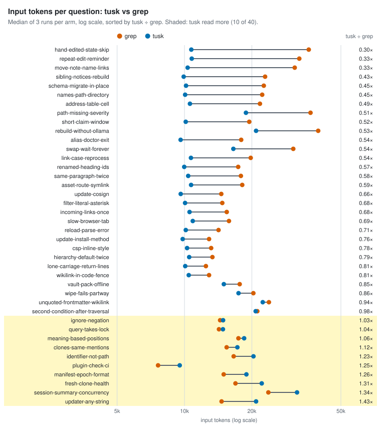
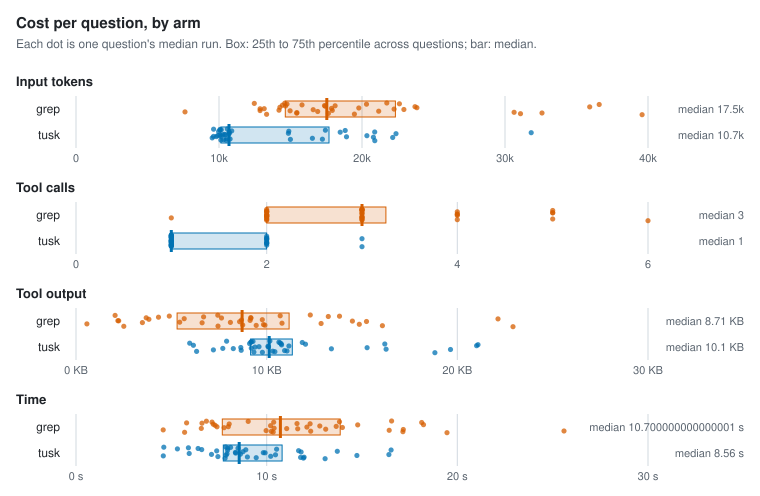
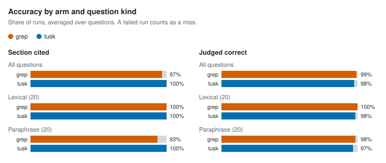

# Agent retrieval benchmark

- Corpus: 35 markdown files, 154 sections (docs/packages)
- Questions: 40, 3 repetitions per arm
- Agent model: claude-sonnet-5-5; judge: haiku
- tusk v1.0.0-dev (84ae654, modified); Claude Code 2.1.301; 4 concurrent runs; 2026-10-16

## Per arm

Each figure is the median over questions of that question's median run, with the 25th to 75th percentile in brackets.

| Arm | Input tokens | Tool calls | Tool output | Time | Cost | Section cited | Judged correct | Runs (failed) |
| --- | --- | --- | --- | --- | --- | --- | --- | --- |
| grep | 17,537 [14,637–22,339] | 3 [2–3.25] | 8.7 KB [5.3 KB–11.2 KB] | 10.7 s [7.7 s–13.9 s] | $0.026 [$0.020–$0.033] | 97% | 99% | 120 (0) |
| tusk | 10,698 [10,136–17,698] | 1 [1–2] | 10.1 KB [9.2 KB–11.3 KB] | 8.6 s [7.7 s–10.8 s] | $0.026 [$0.024–$0.031] | 100% | 98% | 120 (0) |

## tusk vs grep, paired by question

A ratio below 1 means tusk used less than grep on the same question.

| Metric | Median ratio (tusk / grep) | 95% CI | Questions where tusk used less |
| --- | --- | --- | --- |
| Input tokens | 0.70 | 0.58–0.83 | 30 of 40 |
| Tool output | 1.30 | 1.05–1.65 | 13 of 40 |
| Time | 0.86 | 0.69–0.99 | 26 of 40 |
| Cost | 1.09 | 0.93–1.28 | 17 of 40 |

| Metric | Median difference (tusk − grep) | 95% CI | Questions where tusk used fewer |
| --- | --- | --- | --- |
| Tool calls | -1 | -2 to -1 | 34 of 40 |

| Accuracy | grep | tusk | Difference | 95% CI |
| --- | --- | --- | --- | --- |
| Section cited | 97% | 100% | +3 pp | +0 pp to +8 pp |
| Judged correct | 99% | 98% | -2 pp | -5 pp to +2 pp |

### By question kind

| Kind | Questions | Arm | Input tokens | Tool calls | Section cited | Judged correct |
| --- | --- | --- | --- | --- | --- | --- |
| lexical | 20 | grep | 15,780 | 2.5 | 100% | 100% |
| lexical | 20 | tusk | 10,538 | 1 | 100% | 98% |
| paraphrase | 20 | grep | 18,669 | 3 | 93% | 98% |
| paraphrase | 20 | tusk | 10,834 | 1 | 100% | 97% |

### Where tusk lost

11 of 40 questions: tusk read more input tokens than grep, or was judged correct less often.

| Question | Kind | Input tokens (grep → tusk) | Tool calls (grep → tusk) | Judged correct (grep / tusk) |
| --- | --- | --- | --- | --- |
| `clones-same-mentions` Two people clone the same vault on different machines with different files checked out. Will indexing record the same file mentions for both? | paraphrase | 15,431 → 17,231 | 2 → 2 | 100% / 100% |
| `fresh-clone-health` Right after cloning a repo, before anything has been indexed, what does the health check report? | paraphrase | 16,903 → 22,148 | 3 → 2 | 100% / 100% |
| `identifier-not-path` Is an inline code span like `ExtractWikilinks` recorded as a path ref? | lexical | 16,586 → 20,340 | 2 → 2 | 100% / 100% |
| `ignore-negation` Does `[workspace] ignore` in tusk.toml support gitignore-style `!` negation? | lexical | 14,435 → 14,880 | 2 → 1 | 100% / 100% |
| `manifest-epoch-format` What is the on-disk format of `.tusk/manifest-epoch`, and can it be changed? | lexical | 14,973 → 18,914 | 2 → 2 | 100% / 100% |
| `meaning-based-positions` When the 3D view arranges notes by meaning instead of by links, how are their positions computed? | paraphrase | 17,425 → 18,474 | 2 → 2 | 100% / 100% |
| `plugin-check-ci` Why doesn't `make claude-plugin-check` run in CI? | lexical | 7,622 → 9,525 | 1 → 1 | 100% / 100% |
| `query-takes-lock` Does `tusk query` take the workspace lock? | lexical | 14,262 → 14,853 | 3 → 2 | 100% / 67% |
| `renamed-heading-ids` If I rename a heading in a note, do the ids of that section and the sections under it change? | paraphrase | 17,381 → 9,975 | 3 → 1 | 100% / 67% |
| `session-summary-concurrency` When a Claude Code session starts, the vault summary can include several named saved queries. Are those run one after another or concurrently? | paraphrase | 23,705 → 31,834 | 5 → 3 | 100% / 67% |
| `updater-any-string` What could go wrong if the self-updater accepted any string as the release to install? | paraphrase | 14,649 → 20,885 | 2 → 2 | 100% / 100% |

## Per question

| Question | Kind | Arm | Input tokens | Tool calls | Tool output | Time | Section cited | Judged correct | Failed |
| --- | --- | --- | --- | --- | --- | --- | --- | --- | --- |
| `address-table-cell` | lexical | grep | 21,733 | 3 | 12.3 KB | 16.6 s | 100% | 100% | 0 |
| `address-table-cell` | lexical | tusk | 10,579 | 1 | 10.2 KB | 7.9 s | 100% | 100% | 0 |
| `alias-doctor-exit` | lexical | grep | 17,921 | 2 | 8.1 KB | 6.6 s | 100% | 100% | 0 |
| `alias-doctor-exit` | lexical | tusk | 9,612 | 1 | 7.7 KB | 7.1 s | 100% | 100% | 0 |
| `asset-route-symlink` | lexical | grep | 18,120 | 4 | 3.7 KB | 12.3 s | 100% | 100% | 0 |
| `asset-route-symlink` | lexical | tusk | 10,707 | 1 | 10.8 KB | 8.9 s | 100% | 100% | 0 |
| `clones-same-mentions` | paraphrase | grep | 15,431 | 2 | 9.9 KB | 12.3 s | 100% | 100% | 0 |
| `clones-same-mentions` | paraphrase | tusk | 17,231 | 2 | 10.3 KB | 12.0 s | 100% | 100% | 0 |
| `csp-inline-style` | lexical | grep | 13,160 | 2 | 2.2 KB | 8.0 s | 100% | 100% | 0 |
| `csp-inline-style` | lexical | tusk | 10,274 | 1 | 9.6 KB | 9.8 s | 100% | 100% | 0 |
| `filter-literal-asterisk` | paraphrase | grep | 14,756 | 3 | 4.9 KB | 7.1 s | 100% | 100% | 0 |
| `filter-literal-asterisk` | paraphrase | tusk | 10,062 | 1 | 9.2 KB | 8.0 s | 100% | 100% | 0 |
| `fresh-clone-health` | paraphrase | grep | 16,903 | 3 | 12.9 KB | 17.2 s | 100% | 100% | 0 |
| `fresh-clone-health` | paraphrase | tusk | 22,148 | 2 | 19.6 KB | 14.7 s | 100% | 100% | 0 |
| `hand-edited-state-skip` | paraphrase | grep | 35,923 | 5 | 22.1 KB | 14.8 s | 100% | 100% | 0 |
| `hand-edited-state-skip` | paraphrase | tusk | 10,727 | 1 | 10.8 KB | 7.4 s | 100% | 100% | 0 |
| `hierarchy-default-twice` | lexical | grep | 13,332 | 2 | 2.5 KB | 5.7 s | 100% | 100% | 0 |
| `hierarchy-default-twice` | lexical | tusk | 10,498 | 1 | 9.8 KB | 7.8 s | 100% | 100% | 0 |
| `identifier-not-path` | lexical | grep | 16,586 | 2 | 8.6 KB | 7.8 s | 100% | 100% | 0 |
| `identifier-not-path` | lexical | tusk | 20,340 | 2 | 15.3 KB | 7.9 s | 100% | 100% | 0 |
| `ignore-negation` | lexical | grep | 14,435 | 2 | 4.3 KB | 6.6 s | 100% | 100% | 0 |
| `ignore-negation` | lexical | tusk | 14,880 | 1 | 6.0 KB | 10.5 s | 100% | 100% | 0 |
| `incoming-links-once` | paraphrase | grep | 15,446 | 2 | 9.8 KB | 10.0 s | 100% | 100% | 0 |
| `incoming-links-once` | paraphrase | tusk | 10,538 | 1 | 10.9 KB | 7.4 s | 100% | 100% | 0 |
| `link-case-reprocess` | lexical | grep | 19,773 | 4 | 8.7 KB | 12.8 s | 100% | 100% | 0 |
| `link-case-reprocess` | lexical | tusk | 10,689 | 1 | 11.2 KB | 11.8 s | 100% | 100% | 0 |
| `lone-carriage-return-lines` | paraphrase | grep | 12,467 | 2 | 2.1 KB | 9.0 s | 100% | 100% | 0 |
| `lone-carriage-return-lines` | paraphrase | tusk | 10,077 | 1 | 9.3 KB | 8.1 s | 100% | 100% | 0 |
| `manifest-epoch-format` | lexical | grep | 14,973 | 2 | 6.6 KB | 11.6 s | 100% | 100% | 0 |
| `manifest-epoch-format` | lexical | tusk | 18,914 | 2 | 13.4 KB | 10.5 s | 100% | 100% | 0 |
| `meaning-based-positions` | paraphrase | grep | 17,425 | 2 | 9.2 KB | 7.2 s | 100% | 100% | 0 |
| `meaning-based-positions` | paraphrase | tusk | 18,474 | 2 | 12.0 KB | 8.0 s | 100% | 100% | 0 |
| `move-note-name-links` | paraphrase | grep | 31,086 | 4 | 16.1 KB | 17.1 s | 100% | 100% | 0 |
| `move-note-name-links` | paraphrase | tusk | 10,329 | 1 | 10.4 KB | 9.5 s | 100% | 100% | 0 |
| `names-path-directory` | lexical | grep | 22,248 | 2 | 14.5 KB | 12.1 s | 100% | 100% | 0 |
| `names-path-directory` | lexical | tusk | 10,067 | 1 | 9.4 KB | 8.4 s | 100% | 100% | 0 |
| `path-missing-severity` | lexical | grep | 36,584 | 5 | 13.2 KB | 18.1 s | 100% | 100% | 0 |
| `path-missing-severity` | lexical | tusk | 18,824 | 1 | 11.9 KB | 6.4 s | 100% | 100% | 0 |
| `plugin-check-ci` | lexical | grep | 7,622 | 1 | 0.6 KB | 4.6 s | 100% | 100% | 0 |
| `plugin-check-ci` | lexical | tusk | 9,525 | 1 | 7.2 KB | 4.6 s | 100% | 100% | 0 |
| `query-takes-lock` | lexical | grep | 14,262 | 3 | 3.8 KB | 7.3 s | 100% | 100% | 0 |
| `query-takes-lock` | lexical | tusk | 14,853 | 2 | 6.2 KB | 13.7 s | 100% | 67% | 0 |
| `rebuild-without-ollama` | paraphrase | grep | 39,585 | 6 | 22.9 KB | 19.5 s | 67% | 100% | 0 |
| `rebuild-without-ollama` | paraphrase | tusk | 20,892 | 3 | 18.8 KB | 13.1 s | 100% | 100% | 0 |
| `reload-parse-error` | lexical | grep | 14,194 | 3 | 5.4 KB | 10.4 s | 100% | 100% | 0 |
| `reload-parse-error` | lexical | tusk | 10,137 | 1 | 9.2 KB | 8.6 s | 100% | 100% | 0 |
| `renamed-heading-ids` | paraphrase | grep | 17,381 | 3 | 9.2 KB | 11.6 s | 100% | 100% | 0 |
| `renamed-heading-ids` | paraphrase | tusk | 9,975 | 1 | 9.1 KB | 6.6 s | 100% | 67% | 0 |
| `repeat-edit-reminder` | paraphrase | grep | 32,589 | 5 | 8.7 KB | 25.6 s | 100% | 100% | 0 |
| `repeat-edit-reminder` | paraphrase | tusk | 10,776 | 1 | 11.1 KB | 9.0 s | 100% | 100% | 0 |
| `same-paragraph-twice` | paraphrase | grep | 17,867 | 4 | 9.1 KB | 13.6 s | 100% | 100% | 0 |
| `same-paragraph-twice` | paraphrase | tusk | 10,389 | 1 | 10.1 KB | 8.4 s | 100% | 100% | 0 |
| `schema-migrate-in-place` | lexical | grep | 22,612 | 3 | 10.7 KB | 13.8 s | 100% | 100% | 0 |
| `schema-migrate-in-place` | lexical | tusk | 10,162 | 1 | 9.2 KB | 5.9 s | 100% | 100% | 0 |
| `second-condition-after-traversal` | paraphrase | grep | 21,165 | 3 | 10.8 KB | 13.1 s | 100% | 100% | 0 |
| `second-condition-after-traversal` | paraphrase | tusk | 20,799 | 2 | 16.3 KB | 7.9 s | 100% | 100% | 0 |
| `session-summary-concurrency` | paraphrase | grep | 23,705 | 5 | 5.7 KB | 18.2 s | 100% | 100% | 0 |
| `session-summary-concurrency` | paraphrase | tusk | 31,834 | 3 | 21.1 KB | 11.7 s | 100% | 67% | 0 |
| `short-claim-window` | paraphrase | grep | 19,471 | 3 | 7.5 KB | 10.3 s | 100% | 100% | 0 |
| `short-claim-window` | paraphrase | tusk | 10,131 | 1 | 9.3 KB | 11.9 s | 100% | 100% | 0 |
| `sibling-notices-rebuild` | paraphrase | grep | 22,928 | 4 | 15.2 KB | 14.0 s | 67% | 67% | 0 |
| `sibling-notices-rebuild` | paraphrase | tusk | 9,917 | 1 | 8.6 KB | 5.9 s | 100% | 100% | 0 |
| `slow-browser-tab` | paraphrase | grep | 15,801 | 2 | 6.7 KB | 5.8 s | 33% | 100% | 0 |
| `slow-browser-tab` | paraphrase | tusk | 10,891 | 1 | 10.7 KB | 5.3 s | 100% | 100% | 0 |
| `swap-wait-forever` | paraphrase | grep | 30,637 | 3 | 14.9 KB | 16.4 s | 100% | 100% | 0 |
| `swap-wait-forever` | paraphrase | tusk | 16,533 | 1 | 8.7 KB | 10.2 s | 100% | 100% | 0 |
| `unquoted-frontmatter-wikilink` | lexical | grep | 23,842 | 3 | 9.8 KB | 10.2 s | 100% | 100% | 0 |
| `unquoted-frontmatter-wikilink` | lexical | tusk | 22,378 | 2 | 21.0 KB | 8.8 s | 100% | 100% | 0 |
| `update-cosign` | lexical | grep | 14,601 | 3 | 7.4 KB | 6.8 s | 100% | 100% | 0 |
| `update-cosign` | lexical | tusk | 9,623 | 1 | 7.9 KB | 4.6 s | 100% | 100% | 0 |
| `update-install-method` | lexical | grep | 12,877 | 2 | 3.5 KB | 11.1 s | 100% | 100% | 0 |
| `update-install-method` | lexical | tusk | 9,818 | 1 | 8.3 KB | 16.4 s | 100% | 100% | 0 |
| `updater-any-string` | paraphrase | grep | 14,649 | 2 | 7.6 KB | 8.0 s | 100% | 100% | 0 |
| `updater-any-string` | paraphrase | tusk | 20,885 | 2 | 16.2 KB | 16.5 s | 100% | 100% | 0 |
| `vault-pack-offline` | lexical | grep | 17,649 | 3 | 9.5 KB | 10.2 s | 100% | 100% | 0 |
| `vault-pack-offline` | lexical | tusk | 14,994 | 1 | 6.3 KB | 11.8 s | 100% | 100% | 0 |
| `wikilink-in-code-fence` | lexical | grep | 12,875 | 2 | 2.2 KB | 7.4 s | 100% | 100% | 0 |
| `wikilink-in-code-fence` | lexical | tusk | 10,451 | 1 | 10.1 KB | 9.9 s | 100% | 100% | 0 |
| `wipe-fails-partway` | paraphrase | grep | 20,317 | 3 | 13.8 KB | 10.4 s | 100% | 100% | 0 |
| `wipe-fails-partway` | paraphrase | tusk | 17,439 | 2 | 10.6 KB | 8.5 s | 100% | 100% | 0 |

## Charts

<picture>
  <source media="(prefers-color-scheme: dark)" srcset="charts/tokens-tusk-vs-grep-dark.svg">
  
</picture>

<picture>
  <source media="(prefers-color-scheme: dark)" srcset="charts/per-arm-dark.svg">
  
</picture>

<picture>
  <source media="(prefers-color-scheme: dark)" srcset="charts/accuracy-dark.svg">
  
</picture>

