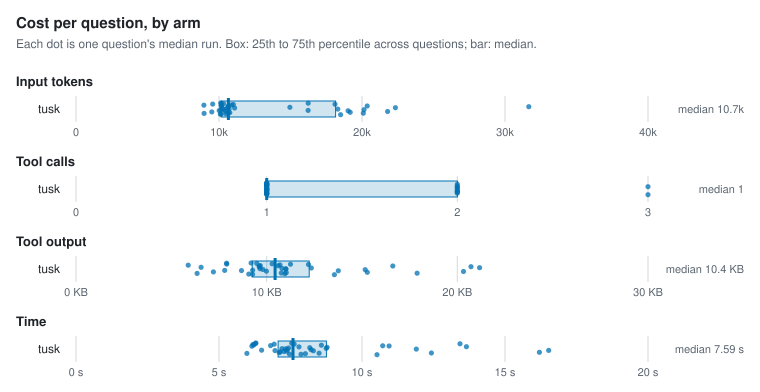
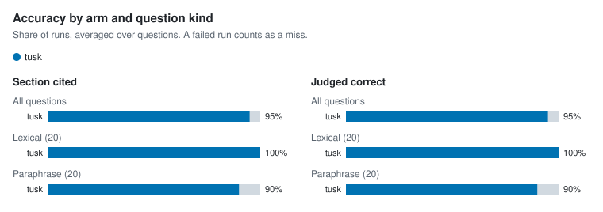

# Agent retrieval benchmark

- Corpus: 35 markdown files, 158 sections (docs/packages)
- Questions: 40, 3 repetitions per arm
- Agent model: claude-sonnet-5-5; judge: haiku
- tusk v1.0.0-dev (d9862cd); Claude Code 2.1.312; 4 concurrent runs; 2026-10-28

## Per arm

Each figure is the median over questions of that question's median run, with the 25th to 75th percentile in brackets.

| Arm | Input tokens | Tool calls | Tool output | Time | Cost | Section cited | Judged correct | Runs (failed) |
| --- | --- | --- | --- | --- | --- | --- | --- | --- |
| tusk | 10,654 [10,155–18,158] | 1 [1–2] | 10.4 KB [9.2 KB–12.2 KB] | 7.6 s [7.1 s–8.8 s] | $0.026 [$0.024–$0.030] | 95% | 95% | 120 (0) |

## Per question

| Question | Kind | Arm | Input tokens | Tool calls | Tool output | Time | Section cited | Judged correct | Failed |
| --- | --- | --- | --- | --- | --- | --- | --- | --- | --- |
| `address-table-cell` | lexical | tusk | 10,126 | 1 | 9.2 KB | 6.3 s | 100% | 100% | 0 |
| `alias-doctor-exit` | lexical | tusk | 16,231 | 1 | 7.8 KB | 16.5 s | 100% | 100% | 0 |
| `asset-route-symlink` | lexical | tusk | 10,661 | 1 | 10.6 KB | 10.7 s | 100% | 100% | 0 |
| `clones-same-mentions` | paraphrase | tusk | 20,092 | 2 | 17.9 KB | 8.5 s | 100% | 100% | 0 |
| `csp-inline-style` | lexical | tusk | 10,256 | 1 | 9.6 KB | 7.2 s | 100% | 100% | 0 |
| `filter-literal-asterisk` | paraphrase | tusk | 9,560 | 1 | 7.9 KB | 7.6 s | 100% | 100% | 0 |
| `fresh-clone-health` | paraphrase | tusk | 21,791 | 2 | 20.3 KB | 7.3 s | 100% | 100% | 0 |
| `hand-edited-state-skip` | paraphrase | tusk | 10,624 | 1 | 9.6 KB | 7.8 s | 100% | 100% | 0 |
| `hierarchy-default-twice` | lexical | tusk | 10,142 | 1 | 9.3 KB | 7.9 s | 100% | 100% | 0 |
| `identifier-not-path` | lexical | tusk | 20,140 | 2 | 15.2 KB | 8.2 s | 100% | 100% | 0 |
| `ignore-negation` | lexical | tusk | 8,942 | 1 | 5.9 KB | 8.6 s | 100% | 100% | 0 |
| `incoming-links-once` | paraphrase | tusk | 10,753 | 1 | 11.0 KB | 7.1 s | 100% | 100% | 0 |
| `link-case-reprocess` | lexical | tusk | 11,094 | 1 | 12.3 KB | 7.4 s | 100% | 100% | 0 |
| `lone-carriage-return-lines` | paraphrase | tusk | 10,151 | 1 | 9.5 KB | 6.3 s | 100% | 100% | 0 |
| `manifest-epoch-format` | lexical | tusk | 19,026 | 2 | 13.8 KB | 8.3 s | 100% | 100% | 0 |
| `meaning-based-positions` | paraphrase | tusk | 10,162 | 1 | 9.6 KB | 6.2 s | 100% | 100% | 0 |
| `move-note-name-links` | paraphrase | tusk | 10,471 | 1 | 11.0 KB | 8.0 s | 100% | 100% | 0 |
| `names-path-directory` | lexical | tusk | 18,305 | 1 | 11.0 KB | 11.9 s | 100% | 100% | 0 |
| `path-missing-severity` | lexical | tusk | 11,010 | 1 | 12.2 KB | 6.2 s | 100% | 100% | 0 |
| `plugin-check-ci` | lexical | tusk | 9,499 | 1 | 7.2 KB | 7.1 s | 100% | 100% | 0 |
| `query-takes-lock` | lexical | tusk | 14,959 | 2 | 6.6 KB | 8.8 s | 100% | 100% | 0 |
| `rebuild-without-ollama` | paraphrase | tusk | 18,502 | 3 | 13.6 KB | 10.5 s | 0% | 0% | 0 |
| `reload-parse-error` | lexical | tusk | 10,126 | 1 | 9.3 KB | 6.5 s | 100% | 100% | 0 |
| `renamed-heading-ids` | paraphrase | tusk | 10,156 | 1 | 9.7 KB | 6.8 s | 100% | 100% | 0 |
| `repeat-edit-reminder` | paraphrase | tusk | 10,648 | 1 | 10.8 KB | 12.4 s | 100% | 100% | 0 |
| `same-paragraph-twice` | paraphrase | tusk | 10,570 | 1 | 10.8 KB | 8.7 s | 100% | 100% | 0 |
| `schema-migrate-in-place` | lexical | tusk | 10,316 | 1 | 10.3 KB | 13.4 s | 100% | 100% | 0 |
| `second-condition-after-traversal` | paraphrase | tusk | 10,446 | 1 | 10.0 KB | 7.4 s | 100% | 100% | 0 |
| `session-summary-concurrency` | paraphrase | tusk | 31,663 | 3 | 20.7 KB | 13.7 s | 100% | 100% | 0 |
| `short-claim-window` | paraphrase | tusk | 10,096 | 1 | 9.1 KB | 7.5 s | 100% | 100% | 0 |
| `sibling-notices-rebuild` | paraphrase | tusk | 10,351 | 1 | 9.8 KB | 7.4 s | 0% | 33% | 0 |
| `slow-browser-tab` | paraphrase | tusk | 10,866 | 1 | 10.7 KB | 6.2 s | 100% | 100% | 0 |
| `swap-wait-forever` | paraphrase | tusk | 19,176 | 2 | 15.3 KB | 16.2 s | 100% | 100% | 0 |
| `unquoted-frontmatter-wikilink` | lexical | tusk | 22,336 | 2 | 21.2 KB | 8.2 s | 100% | 100% | 0 |
| `update-cosign` | lexical | tusk | 16,241 | 1 | 7.9 KB | 7.5 s | 100% | 100% | 0 |
| `update-install-method` | lexical | tusk | 10,012 | 1 | 8.7 KB | 7.0 s | 100% | 100% | 0 |
| `updater-any-string` | paraphrase | tusk | 20,363 | 2 | 16.6 KB | 10.9 s | 100% | 100% | 0 |
| `vault-pack-offline` | lexical | tusk | 8,957 | 1 | 6.4 KB | 6.0 s | 100% | 100% | 0 |
| `wikilink-in-code-fence` | lexical | tusk | 10,709 | 1 | 11.0 KB | 7.3 s | 100% | 100% | 0 |
| `wipe-fails-partway` | paraphrase | tusk | 18,109 | 2 | 11.2 KB | 6.9 s | 100% | 67% | 0 |

## Charts

<picture>
  <source media="(prefers-color-scheme: dark)" srcset="charts/per-arm-dark.svg">
  
</picture>

<picture>
  <source media="(prefers-color-scheme: dark)" srcset="charts/accuracy-dark.svg">
  
</picture>

