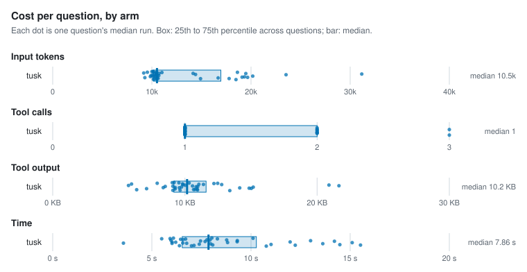
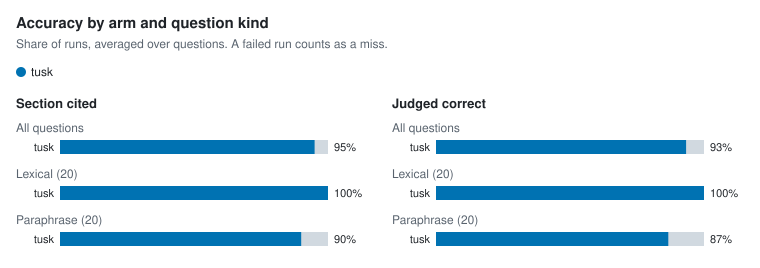

# Agent retrieval benchmark

- Corpus: 35 markdown files, 158 sections (docs/packages)
- Questions: 40, 3 repetitions per arm
- Agent model: claude-sonnet-5-5; judge: haiku
- tusk v1.0.0-dev (d9862cd, modified); Claude Code 2.1.312; 4 concurrent runs; 2026-10-28

## Per arm

Each figure is the median over questions of that question's median run, with the 25th to 75th percentile in brackets.

| Arm | Input tokens | Tool calls | Tool output | Time | Cost | Section cited | Judged correct | Runs (failed) |
| --- | --- | --- | --- | --- | --- | --- | --- | --- |
| tusk | 10,514 [10,154–16,960] | 1 [1–2] | 10.2 KB [9.2 KB–11.6 KB] | 7.9 s [6.5 s–10.3 s] | $0.026 [$0.023–$0.029] | 95% | 93% | 120 (0) |

## Per question

| Question | Kind | Arm | Input tokens | Tool calls | Tool output | Time | Section cited | Judged correct | Failed |
| --- | --- | --- | --- | --- | --- | --- | --- | --- | --- |
| `address-table-cell` | lexical | tusk | 10,126 | 1 | 9.2 KB | 8.0 s | 100% | 100% | 0 |
| `alias-doctor-exit` | lexical | tusk | 9,843 | 1 | 8.4 KB | 3.6 s | 100% | 100% | 0 |
| `asset-route-symlink` | lexical | tusk | 14,162 | 1 | 11.4 KB | 8.8 s | 100% | 100% | 0 |
| `clones-same-mentions` | paraphrase | tusk | 17,789 | 1 | 10.7 KB | 15.5 s | 100% | 100% | 0 |
| `csp-inline-style` | lexical | tusk | 9,920 | 1 | 8.5 KB | 12.0 s | 100% | 100% | 0 |
| `filter-literal-asterisk` | paraphrase | tusk | 9,547 | 1 | 7.9 KB | 5.5 s | 100% | 100% | 0 |
| `fresh-clone-health` | paraphrase | tusk | 19,654 | 2 | 15.0 KB | 8.0 s | 100% | 100% | 0 |
| `hand-edited-state-skip` | paraphrase | tusk | 10,435 | 1 | 10.0 KB | 13.0 s | 100% | 100% | 0 |
| `hierarchy-default-twice` | lexical | tusk | 10,152 | 1 | 9.1 KB | 7.0 s | 100% | 100% | 0 |
| `identifier-not-path` | lexical | tusk | 20,173 | 2 | 15.2 KB | 15.1 s | 100% | 100% | 0 |
| `ignore-negation` | lexical | tusk | 9,180 | 1 | 6.0 KB | 6.6 s | 100% | 100% | 0 |
| `incoming-links-once` | paraphrase | tusk | 10,530 | 1 | 10.9 KB | 14.5 s | 100% | 100% | 0 |
| `link-case-reprocess` | lexical | tusk | 10,487 | 1 | 10.6 KB | 7.7 s | 100% | 100% | 0 |
| `lone-carriage-return-lines` | paraphrase | tusk | 10,154 | 1 | 9.5 KB | 10.1 s | 100% | 100% | 0 |
| `manifest-epoch-format` | lexical | tusk | 19,335 | 2 | 14.1 KB | 6.0 s | 100% | 100% | 0 |
| `meaning-based-positions` | paraphrase | tusk | 10,247 | 1 | 9.9 KB | 6.0 s | 100% | 100% | 0 |
| `move-note-name-links` | paraphrase | tusk | 10,498 | 1 | 11.0 KB | 7.1 s | 100% | 100% | 0 |
| `names-path-directory` | lexical | tusk | 10,553 | 1 | 10.9 KB | 6.2 s | 100% | 100% | 0 |
| `path-missing-severity` | lexical | tusk | 11,011 | 1 | 12.2 KB | 6.7 s | 100% | 100% | 0 |
| `plugin-check-ci` | lexical | tusk | 9,294 | 1 | 7.1 KB | 7.4 s | 100% | 100% | 0 |
| `query-takes-lock` | lexical | tusk | 14,408 | 2 | 5.7 KB | 7.5 s | 100% | 100% | 0 |
| `rebuild-without-ollama` | paraphrase | tusk | 18,486 | 3 | 13.4 KB | 10.8 s | 0% | 0% | 0 |
| `reload-parse-error` | lexical | tusk | 10,126 | 1 | 9.3 KB | 6.6 s | 100% | 100% | 0 |
| `renamed-heading-ids` | paraphrase | tusk | 10,725 | 1 | 11.1 KB | 7.8 s | 100% | 100% | 0 |
| `repeat-edit-reminder` | paraphrase | tusk | 10,639 | 1 | 10.8 KB | 8.1 s | 100% | 100% | 0 |
| `same-paragraph-twice` | paraphrase | tusk | 10,074 | 1 | 9.1 KB | 9.3 s | 100% | 100% | 0 |
| `schema-migrate-in-place` | lexical | tusk | 10,485 | 1 | 10.3 KB | 5.9 s | 100% | 100% | 0 |
| `second-condition-after-traversal` | paraphrase | tusk | 19,098 | 2 | 14.9 KB | 13.6 s | 100% | 100% | 0 |
| `session-summary-concurrency` | paraphrase | tusk | 31,167 | 3 | 20.9 KB | 9.3 s | 100% | 67% | 0 |
| `short-claim-window` | paraphrase | tusk | 10,268 | 1 | 9.6 KB | 6.4 s | 100% | 100% | 0 |
| `sibling-notices-rebuild` | paraphrase | tusk | 10,315 | 1 | 9.8 KB | 8.8 s | 0% | 33% | 0 |
| `slow-browser-tab` | paraphrase | tusk | 10,426 | 1 | 9.8 KB | 6.5 s | 100% | 100% | 0 |
| `swap-wait-forever` | paraphrase | tusk | 16,683 | 2 | 9.3 KB | 11.0 s | 100% | 100% | 0 |
| `unquoted-frontmatter-wikilink` | lexical | tusk | 23,532 | 2 | 21.6 KB | 14.2 s | 100% | 100% | 0 |
| `update-cosign` | lexical | tusk | 10,003 | 1 | 9.0 KB | 6.1 s | 100% | 100% | 0 |
| `update-install-method` | lexical | tusk | 10,335 | 1 | 9.6 KB | 6.8 s | 100% | 100% | 0 |
| `updater-any-string` | paraphrase | tusk | 19,475 | 2 | 12.8 KB | 7.9 s | 100% | 100% | 0 |
| `vault-pack-offline` | lexical | tusk | 14,911 | 1 | 6.4 KB | 12.2 s | 100% | 100% | 0 |
| `wikilink-in-code-fence` | lexical | tusk | 10,698 | 1 | 11.0 KB | 6.0 s | 100% | 100% | 0 |
| `wipe-fails-partway` | paraphrase | tusk | 18,626 | 2 | 12.5 KB | 8.3 s | 100% | 33% | 0 |

## Charts

<picture>
  <source media="(prefers-color-scheme: dark)" srcset="charts/per-arm-dark.svg">
  
</picture>

<picture>
  <source media="(prefers-color-scheme: dark)" srcset="charts/accuracy-dark.svg">
  
</picture>

