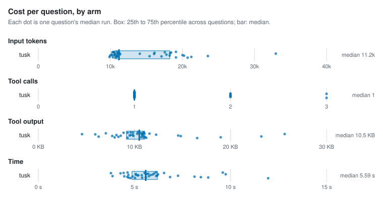
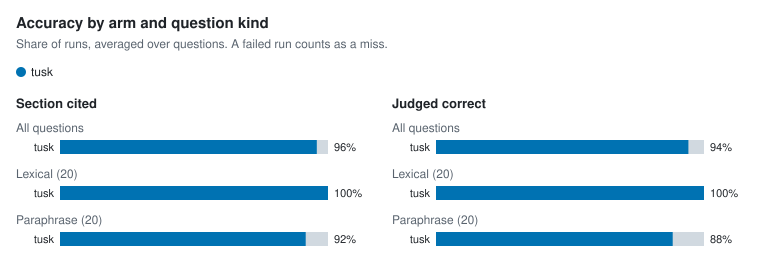

# Agent retrieval benchmark

- Corpus: 36 markdown files, 164 sections (docs/packages)
- Questions: 40, 3 repetitions per arm
- Agent model: claude-sonnet-5-5; judge: haiku
- tusk v1.0.0-dev (a6793f1, modified); Claude Code 2.1.318; 4 concurrent runs; 2026-11-04

## Per arm

Each figure is the median over questions of that question's median run, with the 25th to 75th percentile in brackets.

| Arm | Input tokens | Tool calls | Tool output | Time | Cost | Section cited | Judged correct | Runs (failed) |
| --- | --- | --- | --- | --- | --- | --- | --- | --- |
| tusk | 11,198 [10,607–18,247] | 1 [1–1] | 10.5 KB [9.2 KB–11.1 KB] | 5.6 s [4.9 s–6.2 s] | $0.026 [$0.025–$0.028] | 96% | 94% | 120 (0) |

## Per question

| Question | Kind | Arm | Input tokens | Tool calls | Tool output | Time | Section cited | Judged correct | Failed |
| --- | --- | --- | --- | --- | --- | --- | --- | --- | --- |
| `address-table-cell` | lexical | tusk | 10,911 | 1 | 10.4 KB | 6.1 s | 100% | 100% | 0 |
| `alias-doctor-exit` | lexical | tusk | 18,233 | 1 | 9.9 KB | 3.9 s | 100% | 100% | 0 |
| `asset-route-symlink` | lexical | tusk | 11,273 | 1 | 11.6 KB | 5.6 s | 100% | 100% | 0 |
| `clones-same-mentions` | paraphrase | tusk | 21,237 | 2 | 19.0 KB | 8.8 s | 100% | 100% | 0 |
| `csp-inline-style` | lexical | tusk | 10,152 | 1 | 8.1 KB | 5.4 s | 100% | 100% | 0 |
| `filter-literal-asterisk` | paraphrase | tusk | 17,560 | 1 | 9.3 KB | 4.4 s | 100% | 100% | 0 |
| `fresh-clone-health` | paraphrase | tusk | 23,534 | 2 | 23.2 KB | 8.1 s | 100% | 100% | 0 |
| `hand-edited-state-skip` | paraphrase | tusk | 14,081 | 1 | 4.5 KB | 6.2 s | 100% | 100% | 0 |
| `hierarchy-default-twice` | lexical | tusk | 19,108 | 1 | 11.2 KB | 4.8 s | 100% | 100% | 0 |
| `identifier-not-path` | lexical | tusk | 20,006 | 2 | 14.6 KB | 7.3 s | 100% | 100% | 0 |
| `ignore-negation` | lexical | tusk | 16,125 | 1 | 7.0 KB | 6.0 s | 100% | 100% | 0 |
| `incoming-links-once` | paraphrase | tusk | 10,874 | 1 | 11.1 KB | 8.5 s | 100% | 100% | 0 |
| `link-case-reprocess` | lexical | tusk | 11,367 | 1 | 12.3 KB | 4.7 s | 100% | 100% | 0 |
| `lone-carriage-return-lines` | paraphrase | tusk | 10,421 | 1 | 9.6 KB | 9.6 s | 100% | 100% | 0 |
| `manifest-epoch-format` | lexical | tusk | 20,222 | 2 | 14.8 KB | 4.5 s | 100% | 100% | 0 |
| `meaning-based-positions` | paraphrase | tusk | 10,608 | 1 | 10.3 KB | 5.1 s | 100% | 100% | 0 |
| `move-note-name-links` | paraphrase | tusk | 10,766 | 1 | 11.0 KB | 5.4 s | 100% | 100% | 0 |
| `names-path-directory` | lexical | tusk | 10,801 | 1 | 10.8 KB | 5.2 s | 100% | 100% | 0 |
| `path-missing-severity` | lexical | tusk | 18,428 | 1 | 10.9 KB | 3.8 s | 100% | 100% | 0 |
| `plugin-check-ci` | lexical | tusk | 15,443 | 1 | 6.3 KB | 4.6 s | 100% | 100% | 0 |
| `query-takes-lock` | lexical | tusk | 16,072 | 2 | 5.9 KB | 6.0 s | 100% | 100% | 0 |
| `rebuild-without-ollama` | paraphrase | tusk | 20,719 | 3 | 16.5 KB | 12.0 s | 0% | 0% | 0 |
| `reload-parse-error` | lexical | tusk | 10,258 | 1 | 8.6 KB | 6.1 s | 100% | 100% | 0 |
| `renamed-heading-ids` | paraphrase | tusk | 11,021 | 1 | 11.0 KB | 5.7 s | 100% | 100% | 0 |
| `repeat-edit-reminder` | paraphrase | tusk | 10,905 | 1 | 10.7 KB | 5.6 s | 100% | 100% | 0 |
| `same-paragraph-twice` | paraphrase | tusk | 10,605 | 1 | 9.8 KB | 5.8 s | 100% | 33% | 0 |
| `schema-migrate-in-place` | lexical | tusk | 10,489 | 1 | 9.9 KB | 5.5 s | 100% | 100% | 0 |
| `second-condition-after-traversal` | paraphrase | tusk | 10,996 | 1 | 10.9 KB | 4.9 s | 100% | 100% | 0 |
| `session-summary-concurrency` | paraphrase | tusk | 32,956 | 3 | 25.6 KB | 9.8 s | 100% | 100% | 0 |
| `short-claim-window` | paraphrase | tusk | 10,360 | 1 | 9.3 KB | 5.0 s | 100% | 100% | 0 |
| `sibling-notices-rebuild` | paraphrase | tusk | 10,548 | 1 | 9.5 KB | 6.2 s | 33% | 67% | 0 |
| `slow-browser-tab` | paraphrase | tusk | 11,122 | 1 | 10.6 KB | 4.3 s | 100% | 100% | 0 |
| `swap-wait-forever` | paraphrase | tusk | 17,095 | 1 | 8.3 KB | 6.9 s | 100% | 100% | 0 |
| `unquoted-frontmatter-wikilink` | lexical | tusk | 11,068 | 1 | 10.9 KB | 5.1 s | 100% | 100% | 0 |
| `update-cosign` | lexical | tusk | 19,095 | 1 | 11.0 KB | 4.6 s | 100% | 100% | 0 |
| `update-install-method` | lexical | tusk | 9,969 | 1 | 7.7 KB | 5.8 s | 100% | 100% | 0 |
| `updater-any-string` | paraphrase | tusk | 18,288 | 2 | 10.8 KB | 5.6 s | 100% | 100% | 0 |
| `vault-pack-offline` | lexical | tusk | 9,880 | 1 | 7.9 KB | 4.7 s | 100% | 100% | 0 |
| `wikilink-in-code-fence` | lexical | tusk | 17,786 | 1 | 9.6 KB | 5.2 s | 100% | 100% | 0 |
| `wipe-fails-partway` | paraphrase | tusk | 10,281 | 1 | 8.9 KB | 6.5 s | 100% | 67% | 0 |

## Charts

<picture>
  <source media="(prefers-color-scheme: dark)" srcset="charts/per-arm-dark.svg">
  
</picture>

<picture>
  <source media="(prefers-color-scheme: dark)" srcset="charts/accuracy-dark.svg">
  
</picture>

